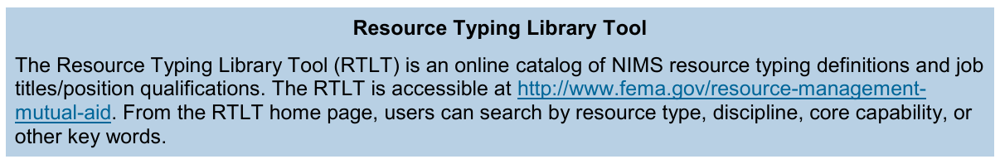
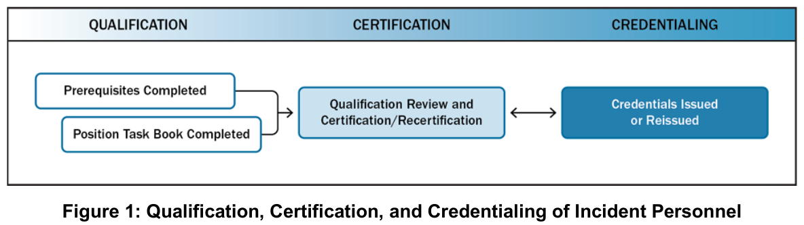
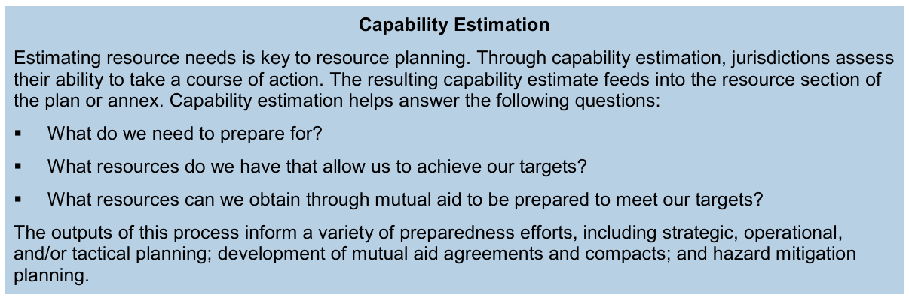
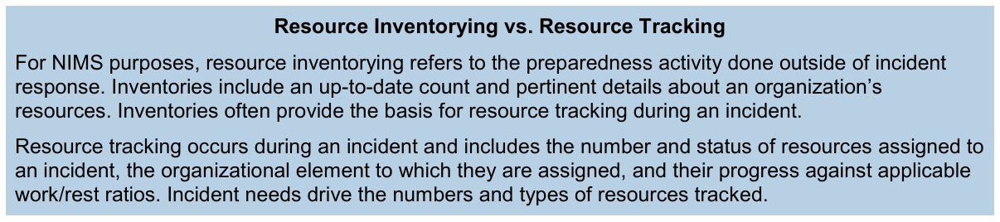
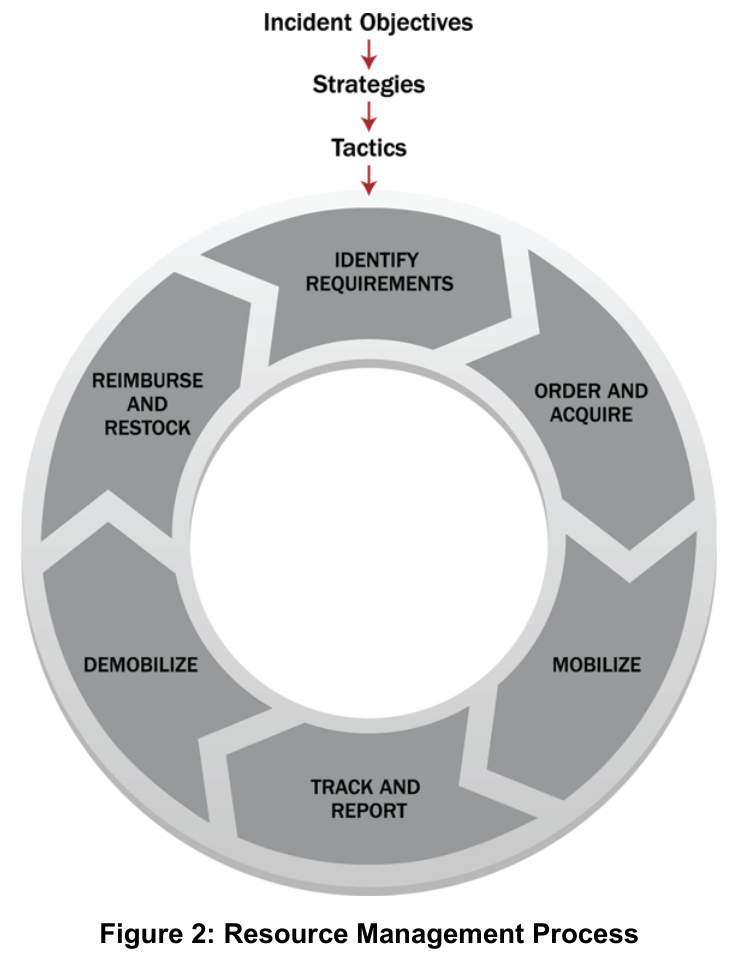
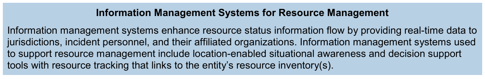
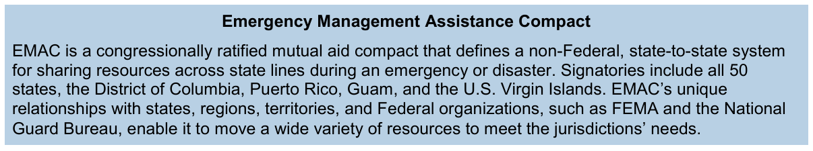

# 제2장 자원관리(Resource Management)

## 전체 구조와 읽는 기준

**서로 다른 기관의 자원을 어떻게 신뢰하고, 요청하고, 운용하며, 다음 사고에 다시 사용할 수 있게 할 것인가?** 이 장의 학습 질문이다. 원문은 인력(Personnel), 팀(Teams), 시설(Facilities), 장비(Equipment), 물자(Supplies)를 자원관리 대상으로 제시한다. 대부분의 관할기관은 모든 위험에 대응할 자원을 자체 보유하지 못하므로 민간·자원봉사조직의 참여와 상호지원(Mutual Aid)이 필요하다(p.6).

여기서 사고(Incident)는 재난·비상상황·계획행사까지 포함하는 포괄적 개념으로 읽는다. 기존 NIMS 학습 자료의 번역 기준을 따른다.

이 페이지의 한국어 설명·비교표·질문은 학습용 재구성이다. **영문 그림 2개와 음영 설명 상자 5개는 제공 PDF에서 캡션·영문·배치를 유지해 추출한 원문 이미지다. 별도 번호 표(Table)는 이 발췌본에 없다.**

| 원문 영역 | 인쇄 쪽 / PDF 쪽 | 주요 내용 |
| --- | --- | --- |
| A. Resource Management Preparedness | 6–11 / 2–7 | 식별·유형화, 인력 자격·인증·증명, 계획, 확보·보관·목록화 |
| B. Resource Management During an Incident | 12–16 / 8–12 | 소요 식별, 요청·확보, 동원, 추적·보고, 동원 해제, 비용상환·재비축 |
| C. Mutual Aid | 17–18 / 13–14 | 협정·협약과 지원 요청·제공 절차 |

A·B·C를 단순한 시간순 3단계로 이해하지 않는다. 상호지원 협정은 사고 전에 준비하며 실제 지원은 사고 중에도 이루어진다. 이 연결은 원문 구조를 설명하기 위한 학습 해석이다.

## 자원의 능력을 공통 언어로 표현하기

자원 유형화(Resource Typing)는 자원을 능력에 따라 정의하고 범주화하는 활동이다. 유형 정의는 인력·팀·시설·장비·물자의 **최소 능력(Minimum Capability)**을 공통 언어로 표현한다. 요청기관은 필요한 능력을 설명하고, 제공받은 자원이 그 능력을 갖추었는지 확인할 수 있다(pp.6–7).

| 구분 | 원문의 뜻을 압축한 학습 설명 |
| --- | --- |
| 역량(Capability) | 해당 자원이 가장 유용하게 기여하는 핵심역량(Core Capability) |
| 기능 분야(Category) | 소방·법집행·보건의료 등 자원이 가장 유용한 기능 |
| 자원 종류(Kind) | 인력·팀·시설·장비·물자와 같은 넓은 성격 |
| 능력 등급(Type) | 해당 기능을 수행하는 최소 능력 수준 |

이 네 가지는 자원을 식별하는 특성이다. 원문은 이를 모든 자원에 적용되는 고정된 4단계 분류 트리로 규정하지 않는다. 같은 자원 정의에서 **Type 1은 Type 2보다, Type 2는 Type 3보다 높은 능력**을 뜻한다. 서로 다른 종류의 자원 등급을 무조건 비교할 수 있다는 뜻은 아니다.

원문 예시는 이동식 급식장비의 식사 생산량과 덤프트럭의 운반용량이다. 장비는 크기·출력·용량, 인력이나 팀은 경험·자격 등이 등급 판단의 근거가 된다(p.7).

전국 수준 유형화 대상 선정에는 널리 사용·공유되는지, 상호지원으로 관할을 넘어 이동 가능한지, 식별·목록화·추적 가능한지, ICS나 EOC에서 사용되는지, 공통 요청·관리·추적체계에서 운용할 만큼 상호운용성 또는 호환성을 갖추었는지도 포함된다(pp.6–7).

자원 유형 정의 목록 도구(Resource Typing Library Tool, RTLT)는 유형 정의와 직위별 자격을 검색하는 목록이다. 실제 보유 자원을 기록한 자원목록(Resource Inventory)과 구별한다. 여기서는 **2017년 교재 설명**만 다루며 현재 도구 운영 상태를 확인한 것으로 제시하지 않는다.

## 사람의 자격을 충족하고 인정하고 증명하기

교육 이수만으로 다른 기관이 그 사람을 특정 직위에 바로 배치할 수 있는 것은 아니다. 원문은 자격 충족, 공식 인정, 문서화의 역할을 나누어 설명한다(pp.7–8).

| 개념 | 무엇을 확인하는가 |
| --- | --- |
| 자격 충족(Qualification) | 교육·경험·신체 및 의학적 적합성·수행능력 등 특정 직위의 최소 기준을 충족하는 과정 |
| 인증·재인증(Certification/Recertification) | 관할 권한기관(AHJ) 또는 제3자가 기준 충족과 지속 충족을 인정하는 것 |
| 자격증명(Credentialing) | 인력을 식별하고 특정 직위 자격을 확인·검증하는 문서 등을 제공하는 것 |

직위별 과업기록서(Position Task Book, PTB)는 최소 역량·행동·과업을 기술하며 수행 기반 자격 확인의 기초가 된다. FEMA는 최소 자격을 권고하지만, 관할 권한기관(Authority Having Jurisdiction, AHJ)이 자신의 관할·조직에서 절차를 수립·운영·유지·감독하며 지역 필요에 따라 추가 요건을 둘 수 있다(p.8).

원문 그림에서 선행요건 이수와 PTB 완료는 자격 검토 및 인증·재인증으로 이어진다. 인증과 증명 사이의 **양방향 화살표**도 원형대로 보존했다. 단순히 한 번 통과하면 끝나는 일방향 절차로 바꾸지 않는다.

자격증명은 **사고별 식별절차(Incident-specific Badging)**와 별개다. 사고별 절차에는 신원 확인·자격·배치 승인이 포함된다. 자격 문서를 보유했다는 사실과 특정 사고 현장에 배치될 승인은 구별해야 한다(pp.7–8).

## 필요한 자원을 사고 전에 계획하기

자원계획(Resource Planning)은 관할·조직의 위협과 취약성을 바탕으로 소요·확보·배분·요청·배치·동원 해제를 준비하는 과정이다. 예방(Prevention), 보호(Protection), 완화(Mitigation), 대응(Response), 복구(Recovery)의 모든 임무영역을 고려한다(pp.8–9).

원문은 네 가지 확보 전략을 제시한다. 사전 비축(Stockpiling), 인접 관할과의 상호지원 협정, 비필수 임무의 기존 자원 재배정, 신속 조달을 위한 공급업체 계약이다. 비축은 유효기간·내구성을 고려해야 하고 적시 조달은 여러 기관이 같은 공급업체의 동일 재고에 의존하는 문제를 확인해야 한다. 기부 자원의 처리·배분 절차도 계획한다(p.9).

역량 추정(Capability Estimation)은 어떤 행동방안을 실행할 수 있는지 평가하고, 무엇에 대비해야 하는지·목표 달성에 어떤 자원을 보유하는지·상호지원으로 무엇을 확보할 수 있는지 묻는다. 급증 수요에 대비한 전진배치(Pre-positioning)와 일정 최소 재고 도달 시 재보충 같은 대응 조건도 계획할 수 있다(p.9).

**학습 해석:** 보유 수량, 자원의 성능, 동원 가능성, 유지 가능한 기간을 연결해서 읽어야 한다. 장비가 존재한다는 사실만으로 필요한 시점의 대응능력이 확보되었다고 판단할 수는 없다.

## 자원목록과 자원추적을 구별하기

원문은 일상 운영 자원과 사고 대비 비축 자원 모두에 대해 정기 보충·예방정비·자본 개선 및 대형 자원에 필요한 부수 지원·물자·공간을 계획하도록 설명한다. 자원목록은 최신성과 정확성을 유지해야 한다(p.9).

| 구분 | 핵심 질문 | 원문 위치 |
| --- | --- | --- |
| 유형 정의 목록(Library) | 어떤 자원이 어떤 최소 능력을 갖추어야 하는가? | p.7 |
| 자원목록(Inventory) | 조직이 어떤 실제 자원을 어떤 상태로 보유하는가? | pp.9–11 |
| 자원추적(Tracking) | 사고 관련 자원이 어디에 배정되어 어떤 상태로 운용되는가? | pp.10, 16 |

이 비교표는 학습용 정리다. 원문 p.10 설명 상자는 목록화를 사고 대응 밖의 대비 활동으로, 추적을 사고 중 활동으로 설명한다. 그러나 p.16 본문은 추적이 **사고 전·중·후**에 이루어진다고 서술한다. 두 위치의 적용 범위에 차이가 있다. 목록과 동원주기 추적을 연결하는 해석은 가능하지만 두 문장이 완전히 같은 정의라고 단정하지 않는다.

효과적인 자원목록의 상위 항목은 이름(Name), 별칭(Aliases), 상태(Status), 유형 정의 또는 직위(Resource Typing Definition or Job Title), 상호지원 준비상태(Mutual Aid Readiness), 본래 위치(Home Location), 현재 위치(Present Location), 연락 담당자(Point of Contact), 소유자(Owner), 제조사·모델(Manufacturer/Model: 장비), 계약(Contracts), 인증(Certifications), 동원정보(Deployment Information)다(pp.10–11).

동원정보에는 최소 준비시간(시간), 최대 동원기간(일), 사용제한, 비용상환 절차, 해제·복귀 지시, 지속 운용에 필요한 사항, 사용자 정의 속성이 포함된다. 본래·현재 위치는 위도·경도와 미국 국가격자망(United States National Grid) 좌표도 포함하도록 기술한다. 인력·장비가 여러 자원집단에 겹쳐 포함되면 중복계상(Double-counting)을 표시해 총량 과대평가를 막아야 한다(pp.10–11).

## 사고목표를 자원 소요로 연결하기

사고 중 자원관리(Resource Management During an Incident)는 다음 **여섯 가지 주요 과업**을 포함한다. 작은 사고에서는 지휘관이 특정 과업의 자원을 직접 식별하고 요청하여 절차가 압축될 수 있다. 복잡한 사고에서는 ICS·EOC의 자원관리 절차와 인력이 필요하다(p.12).

사고목표(Incident Objectives) → 전략(Strategies) → 전술(Tactics)이 원문 그림 위쪽에 놓인다. 이어 소요 식별 → 요청·확보 → 동원 → 추적·보고 → 동원 해제 → 비용상환·재비축이 순환한다. 그림의 순환과 상단 연결은 재작성하지 않았다.

소요 식별(Identifying Requirements)은 필요한 자원의 유형과 수량, 보낼 위치, 받을 사람과 사용할 사람을 지속적으로 확인·검증·수정하는 활동이다. 사고가 변하면 가용성과 필요도 변하므로 기관들은 사고 전부터 가능한 한 일찍 조정해야 한다(p.12).

**학습 해석:** “보유 장비를 모두 보내자”에 앞서 “어떤 목표와 전술에 무엇이 필요한가”를 물어야 한다. 그림은 세부 전술의 공식 정의까지 제공하지는 않는다.

## 요청과 확보에 필요한 정보를 명시하기

요청·확보(Ordering and Acquiring)는 계약, 상호지원 협정, 다른 정부 수준에 대한 지원 요청 등으로 이루어진다. 배분은 사고 우선순위·목표, 조직의 최소 인력 기준 같은 절차, 다른 사고의 자원 수요를 고려한다. 제공조직은 요청에 동의하고 요청 자원과 실제 제공 가능한 자원 사이의 차이를 전달한다(p.13).

원문 자원 요청(Resource Requests) 항목은 다음과 같다(p.13).

- 수량·종류·등급을 포함한 상세 설명. 이를 모르면 필요한 능력이나 사용 목적을 제시한다. 적절한 대체 자원·선호 공급처가 있으면 표시하고 비표준 자원은 상세 제원을 제공한다.
- 필요한 도착 일시.
- 인도 또는 보고 위치.
- 자원이 보고해야 할 담당자의 직위.
- 예방접종·생활 및 작업 조건·환경 위험 등 사고별 보건·안전 우려.

인력은 자격과 사고 수요뿐 아니라 관할의 면허 요건이나 권한 제한도 고려해 배치한다. 다른 관할로 이동했다고 법집행·의료 인력의 권한이 자동으로 확대되는 것은 아니다(p.13).

배치 통보 후에는 최신 상황보고서, 임무·배치 위치·이동 계획, 감독자와 연락처, 배치 서류, 보안·출입·보건 브리핑, 평시 업무의 대체 담당 여부를 확인한다(p.14).

## 동원과 현장 책임관리를 연결하기

현장 도착 인력은 소속기관과 관계없이 등록(Check-in)하고 임무를 받는다. 기록관리(Recordkeeping), 평문·명료한 표현을 통한 통신(Communication), 동원 해제 전 퇴소절차(Checkout)를 지킨다. 퇴소 시에는 진행 업무 처리, 기록 갱신, 장비 반환·이관과 필요시 후임자 인계를 수행한다(p.14).

공식 요청 없이 모이는 무요청 자발 출동(Self-dispatching/Self-deploying)은 추가 감독·지원·안전 수요를 만들고, 원 소속 지역의 서비스 자원을 줄이며, 추적·책임관리와 공식 요청 자원 접근을 방해할 수 있다. 대응인력은 공식 동원 통보를 기다려야 한다(p.14).

동원(Mobilizing)은 요청기관 또는 그 대리 중개자의 통보로 시작한다. 출발 일시·장소, 이동수단, 예상 도착 일시, 보고 위치·직위·연락처, 예상 임무와 기간, 자원 요청번호, 사고번호, 비용·재원 코드를 안내한다(p.15).

동원에는 사고별 배치계획, 장비 지급, 적시 교육(Just-in-time Training), 집결지 지정, 우선순위·예산·일정에 맞춘 자원 전달이 포함된다. 병원·연구소·EOC·대피시설·폐기물 관리시설 같은 **고정시설의 동원은 이동 배치(Deployment) 대신 가동(Activation)의 형태**를 취한다. 따라서 Activation은 동원과 무관한 별도 활동이 아니라 고정시설 동원을 설명하는 방식이다. 동원 해제 계획은 동원을 시작할 때 함께 준비한다(p.15).

## 민간·자원봉사·생존자의 역량을 통합하기

생존자 자원(Survivors as Resources): 대응인력이 도착하기 전에 이웃과 주변 사람이 생명 구조를 돕는 경우가 많다. 공식 대응인력이 도착해도 도움의 의지는 사라지지 않으므로 그 능력을 안전하고 효과적으로 활용할 계획이 필요하다(p.15).

민간·자원봉사조직(Private and Voluntary Organizations): 원문은 American Red Cross와 Medical Reserve Corps 등을 예로 들며, 이러한 조직은 자원봉사자를 사고 활동에 통합할 구조, 지역사회와의 기존 관계, 정부가 제공하기 어려운 지원, 공식 자원 요청 절차에 대한 지원을 제공한다고 설명한다(p.16).

**학습상 구별:** 공식 대응인력의 무요청 출동을 경계하는 것과 지역주민·자원봉사자의 역량을 계획적으로 통합하는 것은 함께 읽어야 한다. 자원봉사 자체를 금지한다는 뜻으로 바꾸지 않는다.

## 추적·복귀·비용상환으로 준비태세 회복하기

추적·보고(Tracking and Reporting)는 동원부터 동원 해제까지 자원을 추적하며, p.16은 사고 전·중·후까지 범위를 기술한다. 수령·활용 준비, 위치 파악, 인력·장비·팀·시설의 안전·보안, 자원 조정과 이동을 지원한다. 근무·휴식 비율에 대한 진척은 p.10 추적 설명 상자에서도 다룬다.

동원 해제(Demobilizing)의 목적은 자원을 **원래 위치와 상태로 질서 있고 안전하며 효율적으로 복귀**시키는 것이다. 요청자와 제공자가 동의하면 복귀 대신 재배정할 수 있다. 기획·지원 기능 인력은 해제 전에 회복·보충·처분·반환 또는 운용 가능한 상태 회복을 계획한다(p.16).

비용상환·재비축(Reimbursing and Restocking)은 다음 사고의 준비태세와 연결된다. 본문은 자원 제공자의 특정 활동 비용 지급, 청구서 수집, 수행 범위에 대한 비용 검증, 손상 장비 교체·수리, 비용상환 프로그램 접근과 적시 지급을 설명한다. 절 제목에 재비축이 포함되지만 별도 상세 재비축 절차를 충분히 제시한 것은 아니다. 동원 해제 절의 보충·상태 회복과 함께 읽는다(p.16).

## 상호지원의 합의와 제공 판단 이해하기

상호지원(Mutual Aid)은 관할 또는 조직 사이에서 자원과 서비스를 공유하는 것이다. 일상적인 경찰·응급의료·소방 지원부터 주 내부 및 주 경계를 넘는 대규모 지원까지 포함한다(p.17).

상호지원 협정·협약(Mutual Aid Agreements and Compacts)은 둘 이상 주체의 자원 공유에 법적 근거를 제공한다. 정부 각 수준·인접 지역·주 간·연방기관·국제적 합의뿐 아니라 부족정부·비정부기구·민간의 공식·비공식 지원 관계도 설명한다(p.17).

비상관리지원협약(Emergency Management Assistance Compact, EMAC)은 원문에서 연방의회가 비준한 비연방 주 간 지원체계로 설명한다. 회원 범위는 **2017년 원문에 기재된 내용**이며 현행 가입 현황을 별도로 검증한 것은 아니다.

협정이 다룰 수 있는 사항은 비용상환, 면허·자격인증 인정, 요청·출동·대응 절차, 음성·데이터 상호운용성, 자원관리 프로토콜이다. 지원은 유상 또는 상호 호혜에 따른 무상일 수 있다. 모든 협정이 같은 항목을 갖추거나 모든 지원이 유상이라고 일반화하지 않는다(p.17).

제공기관은 요청 자원의 일시적 부재를 감당할 수 있는지 판단한다. 소방기관이라면 지원을 보낸 뒤에도 자기 지역의 수요를 충족할 수 있는지 확인한다. 제공 가능하면 구체적 자원을 정하고 협정 조건에 따라 동원한다. 수령기관은 필요에 맞지 않는 자원을 거절할 수 있다(pp.17–18).

## 복습 질문과 출처

1. 자원의 이름이 같아도 같은 능력을 보장하지 못하는 이유는 무엇인가?
2. 자격 충족·인증·자격증명과 사고별 배치 승인은 어떻게 다른가?
3. RTLT의 유형 정의와 실제 기관 자원목록은 어떤 관계인가?
4. 여러 기관이 동일한 공급업체나 같은 인력에 의존하면 어떤 과대평가가 생기는가?
5. Figure 2가 자원 수량보다 사고목표·전략·전술을 먼저 제시하는 이유는 무엇인가?
6. 유형을 모르는 자원을 요청할 때도 반드시 전달해야 할 정보는 무엇인가?
7. 병원이나 EOC는 이동하지 않는데 어떻게 동원되는가?
8. 무요청 출동을 통제하면서 주민과 자원봉사자의 역량을 활용하려면 무엇을 계획해야 하는가?
9. 임무가 끝난 자원을 곧바로 복귀시키는 대신 재배정할 수 있는 조건은 무엇인가?
10. 지원기관이 요청을 받았다고 항상 제공할 수 있는 것은 아닌 이유는 무엇인가?

학습 연결: 제1장의 공통 관리 원칙 → 제2장의 자원 준비·운용·공유 → 제3장의 지휘·지원·정책 조정 → 제4장의 통신·정보 흐름. 이 연결은 학습용 재구성이며 FEMA의 별도 공식 도식이 아니다.

기준 자료: FEMA, *National Incident Management System*, Third Edition, October 2017, Chapter II, 인쇄 pp.6–18. 제공 PDF는 표지 포함 14쪽이며 **PDF 쪽 = 인쇄 쪽 − 4**이다. 원문 그림·상자 이미지는 180 dpi 렌더링에서 주변 여백을 잘라 PNG로 보존했다. 영문·화살표·색상·캡션을 재작성하지 않았다.

사용자 제공 ChatGPT v1.0 노트는 학습 질문과 구조의 참고자료로 사용했다. 외부 보충 링크·자체 품질점수·미제공 다운로드 주장은 근거로 채택하지 않았다. 국내 현행 법제, 현재 FEMA 도구, 교재 밖 실제 사례는 이번 확인 범위에 포함되지 않는다.

## 키워드 보충설명

기존 장의 정의와 설명을 연결한 학습용 보충해설입니다. 뜻풀이 → 구별·적용 → 확인 질문 순서로 읽고, 각 항목의 근거 링크에서 원래 문맥을 확인하세요. 가상 사례와 확인 질문은 수업용 재구성이며 원문 인용이 아닙니다.

### 1. 자원 유형화(Resource Typing)

인력·팀·시설·장비·물자를 최소 수행능력에 따라 공통 언어로 정의하는 활동이다. 이름만 같은 자원 대신 실제로 필요한 일을 할 수 있는 자원을 요청하게 한다.

**구별·적용:** 같은 자원 정의에서 Type 1이 Type 2보다 높은 능력을 뜻한다. 서로 다른 종류의 Type 번호를 비교하거나 모든 자원에 고정된 4단계 분류 트리를 적용하지 않는다.

**확인 질문:** 요청서에 장비 이름 외에 어떤 수행능력을 명시해야 하는가?

**근거:** [제2장 · part-2](https://dadem-nims-study.vercel.app/chapters/02/#part-2)

### 2. 자격 충족·인증·증명(Qualification·Certification·Credentialing)

자격 충족은 직위의 최소 기준을 갖추는 과정, 인증은 권한기관이나 제3자가 그 충족을 공식 인정하는 일, 자격증명은 신원과 직위 자격을 확인할 문서를 제공하는 일이다.

**구별·적용:** 교육 수료, 공식 인정, 문서 확인은 서로 연결되지만 같은 행위가 아니다. 자격증명이 있어도 해당 사고의 출입증 발급과 배치 승인이 자동으로 끝나는 것은 아니다.

**확인 질문:** 이 사람은 무엇을 할 수 있고, 누가 인정했으며, 현장에서 무엇으로 확인하는가?

**근거:** [제2장 · part-3](https://dadem-nims-study.vercel.app/chapters/02/#part-3)

### 3. 관할 권한기관·직위과업서(AHJ·PTB)

직위과업서(PTB)는 직위 수행에 필요한 역량과 과업을 확인하는 데 쓰인다. 관할 권한기관(AHJ)은 자격 기준의 적용과 인증 과정에서 책임을 맡고 추가 요건을 둘 수 있다.

**구별·적용:** 이 장의 AHJ를 사고 현장 전체의 지휘관이라는 뜻으로 확대하지 않는다. 직위 자격의 인정 책임과 현장 임무 지시 권한을 구별한다.

**확인 질문:** 누가 과업 수행을 확인하고, 누가 최종적으로 자격을 인정하는가?

**근거:** [제2장 · part-3](https://dadem-nims-study.vercel.app/chapters/02/#part-3)

### 4. 자원목록·자원추적(Resource Inventory·Resource Tracking)

목록은 어떤 자원을 보유하고 있는지 파악하는 기반이고, 추적은 위치·상태·배치와 이동을 관리하는 활동이다. 실제 소요를 판단하려면 두 정보가 연결되어야 한다.

**구별·적용:** 본문 p.10은 사고 중 추적을 강조하고 p.16은 사고 전·중·후까지 설명한다. 목록은 사고 전, 추적은 사고 중이라는 배타적 시기 구분으로 고정하지 않는다.

**확인 질문:** 목록에는 있지만 이미 다른 임무에 배치된 자원을 어떻게 식별하는가?

**근거:** [제2장 · part-5](https://dadem-nims-study.vercel.app/chapters/02/#part-5)

### 5. 목표·전략·전술(Objectives·Strategies·Tactics)

달성할 결과를 정한 뒤 접근 방법과 구체적 행동을 정하면, 그 행동에 필요한 자원의 종류·능력·수량을 식별할 수 있다. 자원 소요는 계획과 연결해 읽는다.

**구별·적용:** 보유 장비를 먼저 나열하는 것과 임무 수행에 필요한 능력을 계산하는 것은 다르다. 가상 사례에서는 구조 목표를 정한 뒤 접근 방식과 필요한 팀을 검토해 볼 수 있다.

**확인 질문:** 이 자원 요청은 어떤 목표와 구체적 임무를 위해 필요한가?

**근거:** [제2장 · part-6](https://dadem-nims-study.vercel.app/chapters/02/#part-6)

### 6. 동원·전개(Mobilization·Deployment)

요청·확보한 자원을 임무 수행 상태로 준비하고 움직이는 과정이다. 고정 시설도 활성화될 수 있으므로 동원을 모두 물리적 이동으로만 이해하지 않는다.

**구별·적용:** 대응인력의 자발적 무단 전개는 요청·배치·책임성과 충돌한다. 이 원칙을 자원봉사자나 생존자의 도움 자체를 배제하라는 뜻으로 확대하지 않고 안전한 통합 절차와 함께 읽는다.

**확인 질문:** 누가 요청했고 어디로 보고하며 어떤 임무와 지원을 받는가?

**근거:** [제2장 · part-8](https://dadem-nims-study.vercel.app/chapters/02/#part-8)

### 7. 동원해제·비용상환·재보충(Demobilization·Reimbursement·Restocking)

임무 종료 이후에는 자원을 질서 있게 복귀·재배정하고 비용을 확인하며 사용한 물자와 준비태세를 회복해야 한다. 사고 중 관리의 끝을 철수 시점 하나로 보지 않는다.

**구별·적용:** 복귀는 원래 장소·상태로 돌아가거나 상호 합의로 다른 임무에 재배정되는 경우를 포함한다. 비용상환은 비용의 검증과 절차를 거치므로 모든 지출의 자동 지급을 뜻하지 않는다.

**확인 질문:** 자원이 떠난 뒤에도 확인해야 할 비용·장비 상태·물자는 무엇인가?

**근거:** [제2장 · part-10](https://dadem-nims-study.vercel.app/chapters/02/#part-10)

### 8. 상호지원(Mutual Aid)

관할·기관의 자체 능력을 넘어서는 소요를 다른 기관의 인력·장비·물자·서비스와 연결하는 방식이다. 사전 계획에서 협정과 가용성을 검토하는 일이 중요하다.

**구별·적용:** 협정이 있어도 제공기관의 자체 수요와 제공 가능성을 확인해야 한다. 동일 업체·인력이 여러 계획에 잡혀 있으면 장부상의 자원을 중복 계산할 수 있다.

**확인 질문:** 약속된 자원이 동시에 다른 곳에서도 필요할 때 실제 가용량은 얼마인가?

**근거:** [제2장 · part-4](https://dadem-nims-study.vercel.app/chapters/02/#part-4) · [제2장 · part-11](https://dadem-nims-study.vercel.app/chapters/02/#part-11)
