# NIMS 제3장 지휘 및 조정(Command and Coordination)

## 요약

지휘 및 조정(Command and Coordination)은 현장 전술, 대응 지원, 정책적 판단, 대국민 소통을 연결하는 체계다. 공통 용어·조직·절차로 여러 기관의 활동을 맞추면서 각 기관의 권한·책임을 유지한다. 사고지휘체계(Incident Command System, ICS), 비상운영센터(Emergency Operations Center, EOC), 다기관조정그룹(Multiagency Coordination Group, MAC Group), 합동정보시스템(Joint Information System, JIS)이 이 기능의 실행과 연계에 참여한다. (인쇄 p.19)

> [!important] 근거와 범위
> 영문 PDF를 직접 대조했다. 발췌본은 PDF 31쪽이며 인쇄 pp.19–49에 해당한다. 아래 페이지는 모두 영문 인쇄 페이지다. 번역본은 제공되지 않았으므로 번역 오류·번역본 페이지 대응은 검증하지 않았다. 미국 체계에 대한 교재 설명이며 한국 제도와의 동일성을 뜻하지 않는다.

## 자료 정보

- 발췌 제목: III. Command and Coordination.
- PDF 메타데이터 저자: FEMA. 발췌본 본문에는 표지·판권·발행연도가 없다.
- 기존 전체 교재: NIMS 전체 교재(2017년 제3판). 전체 교재 등록 정보는 2017년 10월 제3판이다. 이번 발췌본의 생성일 2026-10-08과 등록일 2026-10-09를 발행연도로 사용하지 않는다.
- PDF 페이지와 인쇄 페이지: PDF 1→인쇄19, PDF 31→인쇄49. 즉 인쇄쪽=PDF쪽+18.
- 그림: 아래 해당 설명에 원문 Figure 3–10 전체 8개를 삽입했다.
- 사용자 참고보고서: 사용자 제공 ChatGPT 학습보고서(원문 검증의 참고자료).

## 장의 구조

| 인쇄 페이지 | 내용 |
| --- | --- |
| 19 | 네 책임 영역과 다기관조정체계(Multiagency Coordination Systems, MACS) |
| 20–23 | NIMS 관리특성(NIMS Management Characteristics) |
| 24–32 | ICS, 지휘·참모, 정보·수사, 시설, 사고관리팀(IMT) |
| 33–34 | 사고관리지원팀(IMAT), 사고복합체(Incident Complex), 광역지휘부(Area Command) |
| 35–39 | EOC 기능·조직형태·가동 및 가동 해제 |
| 40–41 | MAC Group |
| 42–46 | JIS, 공보관(PIO), 합동정보센터(JIC), 대국민 정보처리 |
| 47–49 | 체계 간 연계와 연방 지원·주도 역할 |

## 네 기능과 상호연계

아래는 학습을 위한 기능 중심 정리다. 네 책임 영역과 네 구성요소가 배타적으로 일대일 대응한다는 뜻은 아니다. 원문은 MACS가 구성요소 사이에서 이 책임 영역을 조정한다고 설명한다. (p.19)

| 구성요소 | 주된 역할 | 설명의 경계 |
| --- | --- | --- |
| ICS | 현장 사고관리의 지휘·통제·조정 | ICS에도 조정 기능이 있다. ‘지휘는 ICS, 조정은 EOC’라는 완전한 이분법은 부정확하다. pp.24–25 |
| EOC | 정보 수집·분석·공유, 자원 요청·배분·추적, 계획 조정 | 일부 운영을 맡고, 현장지휘가 수립되지 않은 경우 전술작전을 지휘할 수 있다. p.35 |
| MAC Group | 정책 수준의 공동 판단, 자원 우선순위·배분 | 현장지휘 기능을 수행하거나 작전·조정·출동조직의 기본 기능을 대체하지 않는다. p.40 |
| JIS | 기관 간 메시지와 공보활동의 통합·조정 | 현장/전술·센터/조정·정책/전략의 세 수준을 가로지른다. p.42 |

다기관조정체계(MACS)는 이 네 책임 영역을 구성체계 사이에서 조정하는 체계다. MAC Group은 그 구성요소 하나이며, MACS 전체와 같은 뜻이 아니다. (p.19)

## 관리특성 14개

원문 p.20의 목록을 읽기 순서에 맞춰 정리했다. 세부 설명은 pp.20–23에 있다.

| 번호 | 관리특성 | 핵심 의미 |
| --- | --- | --- |
| 1 | 공통 용어(Common Terminology) | 조직기능·자원·시설 명칭을 표준화한다. |
| 2 | 모듈형 조직(Modular Organization) | 규모·복잡성·위험에 따라 기능을 확장하고 위임한다. 미배치 기능의 책임은 상위 감독자에게 남는다. |
| 3 | 목표관리(Management by Objectives) | 측정 가능한 목표, 전략·전술·임무, 배정, 결과 기록을 연결한다. |
| 4 | 사고대응계획 수립(Incident Action Planning) | 목표·전술·임무를 계획으로 전달한다. 모든 사고에 대응계획이 필요하지만 모두 서면일 필요는 없다. |
| 5 | 적정 통할범위(Manageable Span of Control) | 감독 능력에 맞게 보고·감독 관계를 구성한다. |
| 6 | 사고시설과 위치(Incident Facilities and Locations) | 상황에 따라 지휘·지원 시설을 정하고 위치를 식별한다. |
| 7 | 종합 자원관리(Comprehensive Resource Management) | 인력·장비·팀·물자·시설의 최신 현황을 관리한다. |
| 8 | 통합 통신(Integrated Communications) | 공통 통신계획과 상호운용 가능한 음성·데이터 연결을 마련한다. |
| 9 | 지휘 수립과 이양(Establishment and Transfer of Command) | 지휘를 초기에 정하고, 이양 시 핵심상황 브리핑과 관련 인원 통지를 수행한다. |
| 10 | 통합지휘(Unified Command) | 공동 승인 목표로 사고을 관리하며 참여 기관의 권한·책임을 유지한다. |
| 11 | 지휘계통과 지휘 일원성(Chain of Command and Unity of Command) | 권한의 계통을 명확히 하고 개인은 한 명에게 보고한다. |
| 12 | 책임성(Accountability) | 출입 확인·계획·개인 책임·통할범위·자원 추적으로 책임을 확보한다. |
| 13 | 출동·배치(Dispatch/Deployment) | 적절한 권한자의 요청과 정식 출동 절차를 따른다. 요청 없는 자발적 배치는 삼간다. |
| 14 | 정보 및 첩보 관리(Information and Intelligence Management) | 사고 관련 정보·첩보를 수집·분석·평가·공유·관리한다. |

### 오해하기 쉬운 조건

- **1:5는 권장 기준이다.** 최적 통할범위를 감독자 1명당 부하 5명으로 제시하지만, 실제 대응에서는 상당히 다른 비율도 필요하다. 사고·임무·위험·안전·경험·통신 접근성을 고려해 판단한다. (pp.21–22)
- **서면 IAP의 필요성은 조건부다.** 복잡성, 지휘 판단, 법적 요구에 따른다. 예고 없는 사고의 첫 작전기간에는 정식 IAP가 없을 수 있다. 작전기간이 길어지거나 복잡해지고 여러 관할·기관이 참여하면 서면 IAP의 중요성이 커진다. (p.21)
- **통합지휘와 지휘 일원성은 양립한다.** 기관 수준에서는 공동 목표·전략·단일 IAP를 정하며, 개인 수준에서는 한 명에게 보고한다. 각 기관의 인력·자원에 대한 권한·책임·책임성은 유지된다. (pp.22–26)
- **첩보의 의미는 제한된다.** 각주13은 법집행·의학적 감시·수사조직이 생산하는 위협 관련 정보를 뜻한다고 명시한다. 모든 일반 상황정보와 동일시하지 않는다. (p.23)

## ICS 조직과 시설

## IC·UC·AC는 무엇이 다른가?

IC·UC·AC는 사고 규모에 따라 직급이 올라가는 세 단계가 아니다. **지휘 책임을 맡는 개인**, **권한 있는 기관이 공동으로 지휘하는 방식**, **여러 ICS 조직을 감독하는 조직**을 구별한다. 아래 표는 NIMS 제3장 인쇄 pp.24–26·33–34를 대조한 학습용 재구성이다. 한국어는 이 정리노트의 편집 기준이다.

| 구분 | IC | UC | AC |
| --- | --- | --- | --- |
| 원어·표현 | 사고지휘관(Incident Commander) | 통합지휘부(Unified Command) | 광역지휘부(Area Command) |
| 개념 | 지휘 책임을 맡는 개인의 직책 | 책임·권한이 있는 기관들이 공동 지휘하는 방식과 지휘부 | 복수 ICS 조직의 관리를 감독하는 조직 |
| 관리 범위 | 하나의 ICS 조직. 사고복합체를 맡을 수도 있다. | 하나의 통합 ICS 조직. 사고복합체를 맡을 수도 있다. | 복수 동시 사고 또는 여러 ICS 조직이 필요한 매우 복잡한 사고 |
| 목표·계획 | 부여된 권한 내에서 사고 목표를 설정하고 대응을 총괄 | 공동 목표·우선순위·전략과 하나의 통합 IAP를 정함 | 광역 목표를 설정하고 사고별 목표·전략·자원 우선순위를 조정 |
| 전술 수행 | 해당 ICS 조직의 작전부서가 수행 | 해당 ICS 조직의 작전부서가 수행 | 개별 IC·UC가 맡는 ICS 조직에서 수행 |
| 권한의 경계 | 지정된 사고지휘관의 권한·책임 | 참여기관은 자기 인력·자원에 대한 권한·책임·책무 유지 | 개별 ICS 지휘부를 하나로 합치지 않고 관리를 감독 |
| 원문 근거 | p.24, p.26 | pp.25–26 | pp.33–34 |

### IC — 지정된 지휘관이 사고관리를 책임진다

단일 관할에서 관할권·기능상 책임의 중복이 없는 경우 권한 있는 기관이 단일 사고지휘관을 지정한다. **여러 관할·기관이 관여하더라도 서로 합의하면 단일 IC를 지정할 수 있다.** 따라서 기관 참여 수만으로 UC 적용 여부를 판단하지 않는다. (p.24)

### UC — 권한 있는 기관이 목표와 계획을 함께 정한다

UC는 관할권 또는 사고에 대한 권한·기능상 책임을 가진 기관이 공통 목표·전략과 하나의 IAP로 사고를 공동 관리하도록 한다. UC 참여기관은 협업 과정(collaborative process)을 통해 우선순위와 목표를 정한다. 각 기관의 인력·자원에 대한 권한과 책임은 유지된다. (pp.25–26)

지휘 기능은 **하나의 현장지휘소(ICP), 통합 목표, 단일 자원 주문체계, 작전기간별 통합 사고대응계획(IAP)**을 설정한다. 필요한 일반참모의 각 기능에는 한 명의 부서장을 둔다. 기관마다 별도 작전부서장을 두거나 서로 독립된 지휘소에서 각자 명령하는 뜻이 아니다. 이 지휘 기능의 책임은 단일 IC와 UC 모두에 적용된다. (p.25)

권한·관할 책임이 없는 지원·협조기관도 사고 대응에 참여할 수 있다. 단순히 참여했다는 이유만으로 모두 UC 구성원이 되는 것은 아니다. (p.26)

### AC — 여러 지휘조직의 목표와 부족한 자원을 조정한다

AC는 여러 동시 사고 또는 복수 ICS 조직이 필요한 매우 복잡한 사고의 관리를 감독한다. 여러 현장지휘소가 같은 부족한 자원을 요청하는 상황, 사고의 복잡성, 통할범위를 고려해 설치한다. **사고가 여러 건이라는 사실만으로 자동 설치하는 것은 아니다.** 사고 유형·자원 수요가 서로 다르면 별도 사고로 관리하고 EOC·MAC Group 등의 조정 지원을 받을 수 있다. (pp.33–34)

AC는 사고별 목표·전략의 조정, 변화하는 우선순위에 따른 자원 배분·재배분, IC·UC의 적절한 사고관리 감독, 통신·데이터 조정, 부족한 자원 수요 파악·보고를 맡는다. 개별 현장의 세부 전술은 각 ICS 조직이 담당한다. (p.34)

다관할 운영 가능성이 높은 특성 때문에 AC는 **통합광역지휘부(Unified Area Command)**로 구성되는 경우가 많다. UC와 같은 원리로 공동 지휘한다. (p.33)

### 그림으로 연결해서 읽기

- [그림 3: 단일 IC의 ICS 조직](#그림-3-단일-사고지휘관의-ics-조직)은 한 명의 사고지휘관과 기능별 보고 관계를 보여준다.
- [그림 4: UC의 ICS 조직](#그림-4-통합지휘부의-ics-조직)은 공동 지휘부 아래 하나의 통합 기능조직을 보여준다.
- [그림 6: AC와 복수 사고지휘부](#그림-6-광역지휘부와-복수-사고지휘부)은 복수 지휘조직의 감독과 EOC 지원 조정의 관계를 보여준다.

**개념 적용 예시(가상):** 지정된 IC가 공장 화재를 관리하는 경우, 권한·기능상 책임을 가진 기관들이 화학물질 누출의 목표를 UC에서 함께 정하는 경우, 여러 독립 ICS가 운영되는 산불에서 공통 항공자원 수요를 AC가 조정하는 경우를 생각할 수 있다. 이는 실제 사건이나 FEMA 원문 사례를 보고한 것이 아니다. 실제 지휘방식은 해당 기관의 권한과 사고 조건에 따라 판단한다.

## 지휘참모와 일반참모

ICS는 지휘(Command), 작전(Operations), 계획(Planning), 지원(Logistics), 재무·행정(Finance/Administration)의 다섯 주요 기능으로 구성된다. 사고지휘관(IC) 또는 통합지휘부(UC)는 사고의 필요에 따라 참모와 부서장을 배치한다. (pp.24, 27–28)

| 구분 | 지휘참모(Command Staff) | 일반참모(General Staff) |
| --- | --- | --- |
| 구성 | 공보관·안전담당관·연락관 및 필요에 따른 추가 직책·자문가 | 작전·계획·지원·재무행정 부서장 |
| 역할 | 지휘 기능을 공보·안전·기관 연락 등의 전문 영역에서 지원 | 기능별 부서를 책임지고 사고 목표의 실행을 조직 |
| 보고 관계 | IC·UC에 직접 보고 | IC·UC 아래에서 각 기능을 책임짐 |
| 편성 | 필요에 따라 배치하고 보조 인력을 둘 수 있음 | 필요에 따라 부서장을 배치하고 부책임자를 둘 수 있음 |

### 지휘참모(Command Staff)

IC·UC는 지휘 기능을 지원하도록 지휘참모를 지정한다. 일반적으로 공보관, 안전담당관, 연락관이 지휘부에 직접 보고하며 필요하면 보조 인력을 둔다. 사고 특성에 따라 추가 자문가를 임명할 수 있다. (p.27)

#### 공보관(Public Information Officer, PIO)

공보관은 대중·언론 및 사고 관련 정보가 필요한 다른 기관과 소통하는 창구다. (p.27)

- 사고 정보를 **수집·검증·조정·전파**해 조직 내부와 외부에 의미 있고 시의적절한 정보를 제공한다.
- 영어 사용이 제한된 사람과 장애인을 포함해 누구나 정보에 접근하고 활용할 수 있도록 전달한다.
- 언론과 다른 공공정보 출처를 모니터링하고, 관련 정보를 사고관리조직의 적절한 구성요소에 전달한다.
- 여러 기관의 공보관이 참여하면 IC·UC가 대표 공보관(lead PIO)을 지정한다. 공보관들은 일관된 메시지를 전달하도록 함께 활동한다.
- **사고 관련 정보의 공개는 IC·UC가 승인한다.**
- 대규모 사고에서는 합동정보센터(JIC)에 참여하거나 이를 이끈다.

#### 안전담당관(Safety Officer)

안전담당관은 사고 대응활동을 모니터링하고 대응인력의 건강·안전에 관해 IC·UC에 조언한다. (p.27)

- 위험한 환경을 평가하고, 위험을 전달하며, 위험을 줄이기 위한 체계와 절차를 마련한다.
- 사고 안전계획(Safety Plan)을 작성·유지한다.
- 여러 기관의 안전활동을 조정하고 대응인력과 사고현장의 안전을 높이는 조치를 시행한다.
- **불안전한 행위를 중단하거나 예방한다.** 안전담당관은 조언만 하는 역할에 머물지 않는다.
- 안전한 사고관리에 대한 최종 책임은 IC·UC와 각급 감독자에게 있다.
- 공동 안전관리에 참여하더라도 각 기관은 자기 프로그램·정책·인력에 대한 책임과 권한을 유지한다.

#### 연락관(Liaison Officer)

연락관은 **UC에 포함되지 않은** 정부기관·관할기관·비정부기구(NGO)·민간조직 대표와 사고지휘부를 연결하는 창구다. (p.27)

- 기관 대표가 자기 기관의 정책, 자원 가용성 및 사고 관련 사항을 지휘부에 전달하도록 한다.
- 단일 IC 또는 UC 어느 구조에서도 지원·협조기관 대표들의 활동을 연락관을 통해 조정한다.
- 필요하면 보조 인력을 둘 수 있다.

기관 대표의 참여 통로를 제공하는 역할이며, 기관 대표가 모두 UC의 구성원이 되는 것은 아니다. (pp.26–27)

#### 추가 직책과 지휘 자문가

사고 특성과 지휘부가 정한 요구에 따라 지휘참모 직책을 추가할 수 있다. IC·UC는 기술전문가를 지휘 자문가로 임명할 수 있다. **자문가(advisor)는 자문 역할을 수행하며 사고 활동을 지휘할 권한이 없다.** 따라서 안전담당관처럼 업무상 권한을 가진 담당관(officer)과 구분한다. (p.28)

### 일반참모(General Staff)

일반참모는 작전·계획·지원·재무행정 부서장으로 구성된다. IC·UC가 필요에 따라 부서장을 배치한다. **부서장이 지정되기 전까지 해당 기능은 IC·UC가 책임진다.** 부서장은 필요하면 한 명 이상의 부책임자를 둘 수 있다. (p.28)

#### 작전부서(Operations Section)

작전부서는 IC·UC가 설정한 사고 목표를 달성하도록 전술활동을 계획하고 수행한다. 목표는 일반적으로 인명 보호, 즉각적인 위험 감소, 재산·환경 보호, 상황 통제 및 정상 활동의 회복에 초점을 둔다. (p.28)

IC·UC는 현재 사고 우선순위에 따라 작전부서장(Operations Section Chief)을 선정하고, 사고가 진행됨에 따라 그 선정을 주기적으로 검토한다. 작전부서장은 사고의 성격·범위, 참여 관할·기관, 우선순위·목표·전략에 맞춰 부서를 구성한다.

- IC·UC를 대신해 전술활동의 관리를 지휘한다.
- 사고 목표를 달성할 전략과 전술을 개발하고 실행한다.
- 사고의 필요에 맞게 작전부서를 편성하고, 관리 가능한 통할범위를 유지하며 자원을 효과적으로 활용한다.
- 각 작전기간의 사고대응계획(IAP) 수립을 지원한다.

#### 계획부서(Planning Section)

계획부서는 사고 상황정보를 수집·평가·전파해 IC·UC와 대응인력에게 제공한다. 상황보고서를 작성하고 상황정보를 표시하며 배치된 자원의 상태를 관리한다. 사고대응계획 수립 과정을 진행하고, 다른 부서·지휘참모의 의견과 IC·UC의 지침을 바탕으로 IAP를 작성한다. (pp.28–29)

- 사고 계획회의를 진행한다.
- 자원의 현재 상태와 예상되는 자원 수요를 기록한다.
- 사고 현황을 수집·정리·표시·전파하고 변화하는 상황을 분석한다.
- 자원을 질서 있고 안전하며 효율적으로 동원 해제할 계획을 수립한다.
- 모든 사고 관련 문서를 수집·기록·보호한다.

계획부서는 여러 부서의 내용을 모아 IAP를 작성하며, 지휘부는 각 작전기간의 통합 IAP를 승인한다. (pp.25, 28–29)

#### 지원부서(Logistics Section)

지원부서는 자원 주문을 포함해 사고관리에 필요한 서비스와 지원을 제공한다. 시설과 시설·인력의 보안, 운송, 물품, 장비 정비·연료, 급식, 통신·정보기술(IT), **대응인력의 의료서비스**를 담당한다. (p.29)

- 사고 관련 자원을 주문·수령·보관 또는 수용하고 처리한다.
- 지상 운송을 제공하고 차량을 정비·보급한다. 차량 사용기록을 유지하고 사고 교통계획을 수립한다.
- 사고 시설을 설치·유지·보호하고 동원 해제한다.
- 음식·식수 수요를 산정하고 급식 주문·조리시설·급식구역을 관리한다. 안전담당관과 협력해 식품 보안·안전을 관리한다.
- 사고 통신계획(Communications Plan)을 유지한다. 통신·IT 장비를 확보·설치·지급·유지하고 관리기록을 유지한다.
- 사고 대응인력에게 의료서비스를 제공한다.

여기서 의료서비스의 대상은 사고 대응인력이다. (p.29)

#### 재무·행정부서(Finance/Administration Section)

IC·UC는 현장 또는 사고별 재무·행정 지원이 필요할 때 이 부서를 설치한다. 인력의 근무시간 기록, 임차 협상·공급업체 계약, 청구 처리, 사고 비용 추적·분석을 담당한다. 계획·지원부서와 긴밀히 협력해 **활동기록과 재무문서를 대조**한다. (pp.29–30)

여러 재원으로 대응하는 크고 복잡한 사고에서는 재원별 자금과 발생 비용을 추적·보고한다. 이를 통해 IC·UC가 필요를 예측하고 추가 자금을 요청할 수 있도록 한다.

- 비용을 추적·분석하고 추정치를 작성하며 비용 절감 방안을 권고한다.
- 사고로 인한 재산 피해와 대응인력의 부상·사망에 관련된 재무 문제를 분석·보고·기록한다.
- 임차와 공급업체 계약의 재무 사항을 관리한다.
- 분석·의사결정을 위한 행정 데이터베이스와 스프레드시트를 관리한다.
- 사고 대응인력과 임차 장비의 사용시간을 기록한다.

### 정보·수사 기능(Intelligence/Investigations Function)

일반적으로 계획부서는 작전정보를 수집·분석하고 상황인식을 공유하며, 작전부서는 전술활동을 수행한다. 범죄·테러 또는 역학조사처럼 정보 수집과 수사가 집중적으로 필요한 사고에서는 IC·UC가 정보·수사 책임의 배치를 조정할 수 있다. (pp.30–31)

- 잠재적인 불법행위·사고·공격을 예방하거나 억제한다.
- 정보·첩보·상황인식 자료를 수집·처리·분석·보호·전파한다.
- 증거·검체를 식별·기록·처리·수집하고, 인계·보관 이력(chain of custody)을 구축해 보호·검사·분석·보관한다.
- 가해자 식별·체포로 이어지는 철저한 수사를 수행한다.
- 실종자 및 대규모 사망사고 관련 조사를 수행한다.
- 후속 공격과 피해 확대를 예방해 대응인력을 포함한 생명 보호활동을 지원한다.
- 질병 유행·화재·복합 공격·사이버 사고 등의 원인이나 발생원을 확인해 영향을 통제하고 유사 사고를 예방한다.

**IC·UC가 이 기능의 범위와 조직 내 배치 위치를 최종 결정한다.** 배치 선택지는 NIMS Appendix A, Tab 6에서 다룬다. (p.31)

### 역할을 연결해서 읽기

| 업무 | 역할 연결 |
| --- | --- |
| IAP 수립 | 작전부서가 전술 내용을 제공하고, 계획부서가 다른 부서·지휘참모의 의견을 통합해 작성하며, IC·UC가 승인 |
| 위험 관리 | 안전담당관이 위험 평가·전달·완화 체계와 안전계획을 마련하고 불안전한 행위를 중단·예방. 최종 책임은 IC·UC와 각급 감독자 |
| 기관 참여 | UC의 권한 있는 구성원은 공동 목표를 정하고, UC 외 지원·협조기관 대표는 연락관을 통해 참여 |
| 정보 공개 | 공보관이 정보를 수집·검증·조정·전파하고, IC·UC가 공개 승인 |
| 활동·비용 기록 | 계획·지원부서의 활동기록과 재무·행정부서의 재무문서를 대조 |

참고: NIMS 제3장 인쇄 pp.27–31. [그림 3: 단일 IC 조직](#그림-3-단일-사고지휘관의-ics-조직)과 [그림 4: UC 조직](#그림-4-통합지휘부의-ics-조직)에서 보고 관계를 함께 확인한다.

### 그림 3. 단일 사고지휘관의 ICS 조직

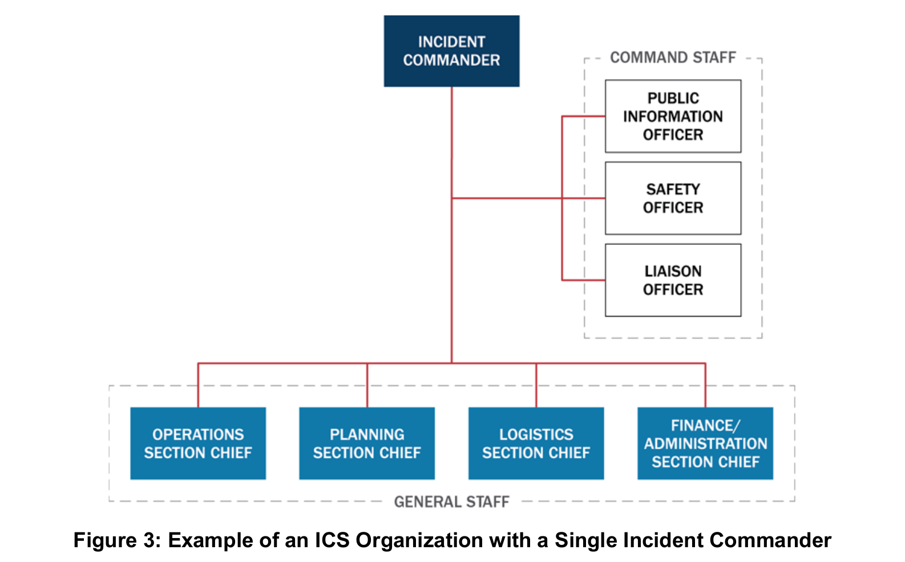

*원문 Figure 3, 인쇄 p.25 / PDF p.7. 원문 도식을 그대로 추출했으며 한국어 제목은 학습용 설명이다.*

### 그림 4. 통합지휘부의 ICS 조직

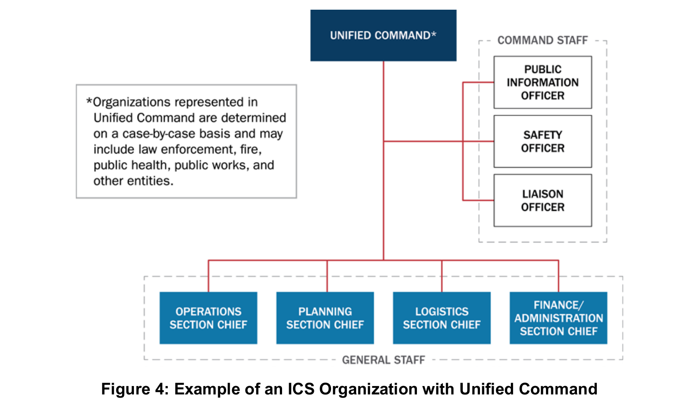

*원문 Figure 4, 인쇄 p.26 / PDF p.8. 원문 도식을 그대로 추출했으며 한국어 제목은 학습용 설명이다.*

### 시설과 사고관리팀

| 명칭 | 역할 | 인쇄 페이지 |
| --- | --- | --- |
| 현장지휘소(Incident Command Post, ICP) | 현장 전술 수준 지휘·계획의 거점 | 31 |
| 대기구역(Staging Area) | 임무 배정을 기다리는 자원을 배치·추적. 작전부서가 관리한다. | 31 |
| 사고기지(Incident Base) | 주요 지원활동의 거점. ICP와 같은 위치일 수 있다. | 31 |
| 캠프(Camp) | 사고기지의 위성 지원거점. 식사·숙박·위생 등을 제공한다. | 32 |
| 사고관리팀(Incident Management Team, IMT) | ICS 자격 인력의 편성팀. 사고관리 또는 지원 임무를 맡는다. | 32 |
| 사고관리지원팀(Incident Management Assistance Team, IMAT) | 현장·피해 관할 지원을 강조하는 팀. 일부 자원·대응 활동의 지휘통제 권한도 가질 수 있다. | 33 |

### 그림 5. 사고 시설별 기능

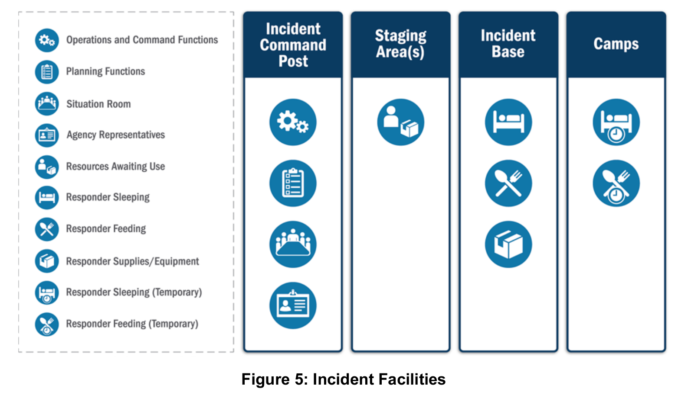

*원문 Figure 5, 인쇄 p.32 / PDF p.14. 원문 도식을 그대로 추출했으며 한국어 제목은 학습용 설명이다.*

## 여러 사고의 관리

- **사고복합체(Incident Complex):** 같은 일반 지역의 두 개 이상 사고를 한 지휘관/통합지휘부와 하나의 ICS 조직 아래 둔다. 개별 사고는 작전부서의 Branch 또는 Division이 된다. 대형화될 사고는 별도 ICS로 관리해야 한다. (p.33)
- **광역지휘부(Area Command):** 여러 동시 사고 또는 여러 ICS가 필요한 매우 복잡한 사고의 관리를 감독한다. 자원 경쟁·우선순위·사고 목표의 충돌을 조정한다. 개별 ICS 지휘부를 하나로 합치는 개념은 아니다. (pp.33–34)
- **Figure 6의 관계:** Area Command는 복수 사고관리를 감독하고, EOC는 지원을 조정하며, MAC Group은 Area Command와 EOC에 정책 지침·전략 방향을 제공한다. (p.34)

## 사고복합체와 AC — ICS 조직 수를 비교한다

이 노트는 Incident Complex를 기존 표현인 **사고복합체**로 통일한다. ‘복합사고 관리체계’는 같은 개념의 기능을 풀어 쓴 번역 후보이며 공식 표준으로 확정한 명칭이 아니다.

| 구분 | 사고복합체(Incident Complex) | 광역지휘부(Area Command) |
| --- | --- | --- |
| 관리 대상 | 같은 일반 지역의 둘 이상 사고 | 복수 사고 또는 복수 ICS가 필요한 매우 복잡한 사고 |
| ICS 조직 | 하나 | 여러 개 |
| 지휘 구성 | 하나의 IC 또는 UC | 각 ICS의 IC·UC를 AC 또는 통합광역지휘부가 감독 |
| 편성·목적 | 개별 사고를 작전부서의 Branch·Division으로 편성. 통합관리의 인력·지원 효율을 고려 | 각 ICS 조직을 유지하며 목표 충돌·부족한 자원 경쟁·관리 범위를 조정 |
| 주요 조건 | 하나의 지휘·일반참모가 충분히 관리할 수 있어야 함. 대형화될 사고는 별도 ICS로 관리 | 복수 지휘소의 자원 경쟁·복잡성·통할범위를 고려 |
| 근거 | p.33 | pp.33–34 |

## AC·EOC·MAC Group — 감독·지원·정책의 역할

| 구성요소 | 주된 역할 | 설명의 경계 |
| --- | --- | --- |
| AC | 복수 사고지휘조직의 관리 감독, 목표·전략 및 자원 배분 조정 | 개별 ICS 조직을 하나로 합치지 않음 |
| EOC | 정보·자원·계획 등 대응 지원의 조정 | AC와 같은 현장 상위지휘부로 정의하지 않음. 현장지휘가 수립되지 않았을 때 전술작전을 지휘할 수 있는 예외는 p.35에 별도 설명 |
| MAC Group | AC·EOC에 정책 지침·전략 방향 제공, 정책 수준의 자원 우선순위·배분 | 현장지휘나 작전·조정·출동조직의 기본 기능을 대체하지 않음. pp.40–41 |

**그림 6을 읽을 때:** 도식은 AC 아래 복수 사고지휘부와 EOC의 지원 조정을 보여준다. MAC Group의 정책 역할은 그림 옆 캡션·본문에서 설명되며, 그림 안에 별도 MAC Group 상자가 있는 것은 아니다. (p.34)

### 적용을 판단하는 질문

1. 한 ICS 조직의 지휘 책임을 한 사람이 맡을 수 있는가? 단일 IC의 권한·합의 조건을 살핀다.
2. 관할권·권한·기능상 책임을 가진 기관들이 공동으로 목표를 정해야 하는가? UC의 구성과 통합 운영을 검토한다.
3. 하나의 ICS로 여러 사고를 충분히 관리할 수 있는가, 여러 ICS 사이에 자원 경쟁과 감독 필요가 있는가? 사고복합체와 AC를 구별한다.

이 질문은 학습용 판단 순서이며 조직을 자동 선택하는 법적 규칙이나 재난 단계표가 아니다.

### 그림 6. 광역지휘부와 복수 사고지휘부

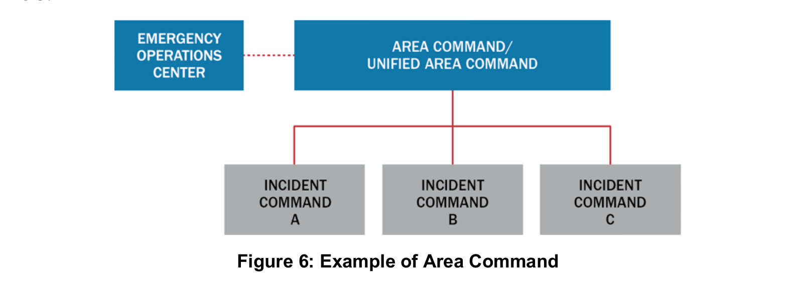

*원문 Figure 6, 인쇄 p.34 / PDF p.16. 원문 도식을 그대로 추출했으며 한국어 제목은 학습용 설명이다.*

## EOC 조직과 가동

EOC는 고정 시설·임시 시설·가상 구조로 운영할 수 있다. 부서운영센터(Departmental Operations Center, DOC)는 주로 자기 기관의 자원·작전을 관리한다. NIMS가 다루는 EOC는 본질적으로 여러 분야의 협력 활동이다. (p.35)

세 가지 조직형태는 예시이며 임무·권한·인력·참여기관·시설·통신 등을 고려해 선택한다. 모두 NIMS 관리특성을 따른다. (pp.36–38)

1. **ICS형 또는 유사형(ICS or ICS-like):** 현장 조직과 대응되는 구조를 쓰되 지원·조정 성격에 맞게 직책명을 조정할 수 있다.
2. **사고지원모형(Incident Support Model, ISM):** 상황인식을 계획에서 분리하고 작전·지원 기능을 사고지원 구조로 결합한다. 자원 확보·주문·추적을 간소화한다.
3. **부서형(Departmental):** 평시 부서·기관 관계를 활용한다. 비상관리 담당자 또는 고위 책임자가 기관 간 활동을 조정한다.

### 그림 7. ICS 유사형 EOC 조직

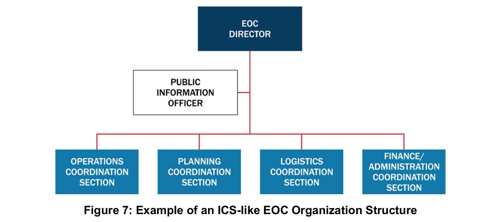

*원문 Figure 7, 인쇄 p.37 / PDF p.19. 원문 도식을 그대로 추출했으며 한국어 제목은 학습용 설명이다.*

### 그림 8. 사고지원모형(ISM) EOC 조직

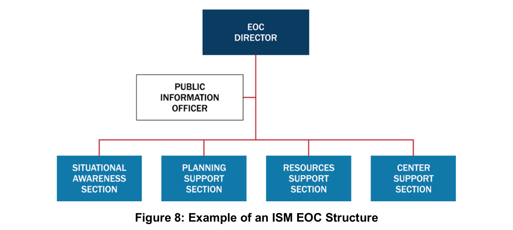

*원문 Figure 8, 인쇄 p.37 / PDF p.19. 원문 도식을 그대로 추출했으며 한국어 제목은 학습용 설명이다.*

### 그림 9. 부서형 EOC 조직

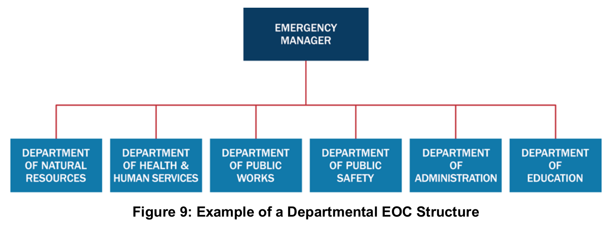

*원문 Figure 9, 인쇄 p.38 / PDF p.20. 원문 도식을 그대로 추출했으며 한국어 제목은 학습용 설명이다.*

### 가동 수준 — Table 2, p.39

| 수준 | 원문 명칭 | 내용 |
| --- | --- | --- |
| 3 | Normal Operations/Steady State | 정상 운영, 평시 감시·경보 |
| 2 | Enhanced Steady-State/Partial Activation | 일부 구성원이 신뢰할 만한 위협을 감시하거나 발전 가능성이 있는 사고을 지원 |
| 1 | Full Activation | 주요 사고·신뢰할 만한 위협에 대응하도록 지원기관 인력을 포함한 EOC팀 가동 |

외부 소통에는 표준 가동 명칭을 사용한다. 내부에서는 숫자·색상도 쓸 수 있으며, 숫자를 쓰면 작아질수록 높은 가동 수준이 되도록 한다. 각 수준은 대면·원격 참여가 가능하다. 가동 해제(Deactivation)는 지원·조정 수요가 줄거나 다른 체계로 수행 가능할 때 단계적으로 할 수 있으며, 자원 동원해제·잔여 활동 이관·사후 검토 계획을 포함한다. (pp.38–39)

## MAC Group의 정책 판단

관할의 법·정책에 따라 MAC Group이 추가 자원을 승인하거나 EOC·현장지휘부에 지침을 제공할 수 있다. 현장지휘 기능을 대신한다는 뜻은 아니다. (p.40)

MAC Group은 기관 관리자·고위 책임자·그 대리인 등으로 구성하고 대체로 합의에 기초해 판단한다. 대리인은 자기 조직을 대표하거나 사고활동에 자원·예산을 투입할 권한을 받아야 한다. 자금·물자가 없어도 관계·정치적 영향력·전문성을 가진 기관이 참여할 수 있다. 가상 방식으로 운영할 수 있으며 EOC 인력이 지원하거나 일부 활동을 수행할 수도 있다. (pp.40–41)

## JIS와 JIC

JIS는 공보의 과정·절차·도구를 연결하는 체계이며, 합동정보센터(Joint Information Center, JIC)는 그 활동을 수행하는 거점이다. JIC는 독립 거점·사고현장·EOC 구성요소로 설치할 수 있다. 원칙적으로 단일 JIC를 두지만 넓은 지역·복합 사고에서는 복수의 물리적 또는 가상 JIC를 둘 수 있으며 메시지와 최종 공개 권한을 조정해야 한다. (pp.42–44)

### JIC 유형 — Table 3, p.44

| 유형 | 기능 |
| --- | --- |
| 사고형(Incident JIC) | 현장 관련 PIO의 공동 근무 거점. EOC에 둘 수 있다. |
| 가상형(Virtual JIC) | 물리적 공동 근무가 어려울 때 기술·통신 규약으로 연결한다. |
| 위성형(Satellite JIC) | 주 JIC를 지원하며 그 통제 아래 운영한다. |
| 광역형(Area JIC) | 넓은 지역의 복수 사고 ICS를 지원한다. |
| 국가형(National JIC) | 통상 장기 사고에서 연방 사고관리를 지원한다. |

정보처리는 **수집(Gathering)→검증(Verifying)→조정(Coordinating)→전파(Disseminating)**의 지속적 순환이다. 공통 메시지와 권한자의 승인을 조정하고, 승인 절차는 적시에 공개할 수 있도록 간소화한다. 영어 능력·장애·접근 및 기능상 필요를 고려한 다양한 형식을 제공한다. 기관별 정책·프로그램 정보 통제권은 유지한다. 소문·부정확한 정보·정보 공백도 모니터링한다. (pp.43–46)

## 지방·주·연방 체계의 연계

지역에서 확보할 수 없는 자원은 상호원조와 주·부족·영토·주간 지원으로 확대한다. 연방 개입은 주지사·부족 지도자의 요청 승인, 연방 이해관계, 법률상 권한·의무 등의 조건에 따른다. 연방은 지원 역할을 수행할 수 있고, 연방 소유지·주된 연방 관할 등에서는 주도할 수도 있다. Figure 10은 **주로 지원 역할을 하는 경우**의 통합을 보여주며 모든 사고의 고정 지휘구조가 아니다. (pp.47–49)

### 그림 10. 연방정부가 주로 지원 역할을 하는 대응 연계

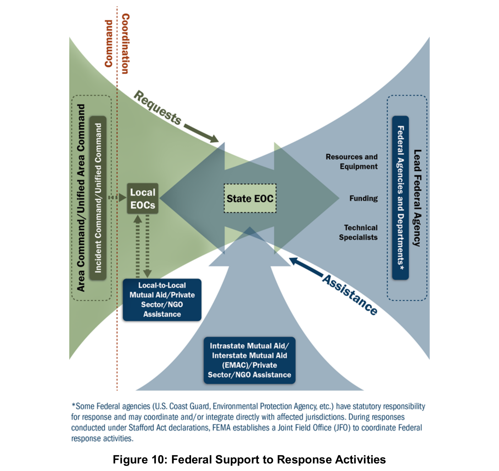

*원문 Figure 10, 인쇄 p.48 / PDF p.30. 원문 도식을 그대로 추출했으며 한국어 제목은 학습용 설명이다.*

## 그림·표 찾아보기

| 번호 | 인쇄쪽 / PDF쪽 | 학습 초점 |
| --- | --- | --- |
| Figure 3 | 25 / 7 | 단일 사고지휘관의 ICS 예시 |
| Figure 4 | 26 / 8 | 통합지휘부의 ICS 예시 |
| Figure 5 | 32 / 14 | 사고 시설 |
| Figure 6 | 34 / 16 | Area Command·EOC·MAC Group 관계 |
| Figure 7 | 37 / 19 | ICS 유사형 EOC |
| Figure 8 | 37 / 19 | ISM형 EOC |
| Figure 9 | 38 / 20 | 부서형 EOC |
| Figure 10 | 48 / 30 | 연방정부가 주로 지원 역할을 하는 연계 |
| Table 2 | 39 / 21 | EOC 가동 수준 |
| Table 3 | 44 / 26 | JIC 유형 |

## 근거와 후속 작업

- NotebookLM JSON의 `references`는 빈 목록이다. 답변에 표시된 페이지를 근거 payload로 간주하지 않았으며, 직접 원문과 별도 검토로 대조했다. 서면 IAP 의무 강화, p.19 대국민 소통을 p.20으로 표기한 오류, DOC에 대한 “자사” 표현을 교정했다.
- NotebookLM 분석은 동일 원문의 반복 질의이므로 독립 증거로 세지 않았다.
- 독립 읽기 전용 검토 후 주장·조건·쪽수를 대조하고 교정했다.
- 복습 흐름과 번역 검토 보류 목록: [복습 정리](study-guide.md).
- 관련 전체 교재: NIMS 전체 교재(2017년 제3판).

## 번역 기준과 FEMA 보충 용어

사고(Incident)은 계획된 행사·비상상황·재난을 포함한다. 일반 개념어는 사고로 통일하고 사고지휘체계·사고지휘관·현장지휘소를 유지한다. [번역 기준과 FEMA 용어 정리](terms.md)를 함께 읽는다. 한국어는 학습용 번역이며 FEMA 보충 자료와 NIMS 제3장의 출처를 구분한다.

## Q방법론 연구 연결

[연구 연결안](q-research.md)에서 지휘·조정 원칙을 적용하는 실무자의 판단 논리, 예비 진술문과 관련 선행연구를 살펴봅니다. 제3장 원문 설명과 구분한 연구 설계 제안입니다.

## 키워드 보충설명

기존 장의 정의와 설명을 연결한 학습용 보충해설입니다. 뜻풀이 → 구별·적용 → 확인 질문 순서로 읽고, 각 항목의 근거 링크에서 원래 문맥을 확인하세요. 가상 사례와 확인 질문은 수업용 재구성이며 원문 인용이 아닙니다.

### 1. 사고지휘체계(ICS)

사고 목표와 임무를 중심으로 지휘·작전·계획·군수·재무행정 기능을 조직하는 공통 관리체계다. 모든 기능을 별도 직위로 즉시 설치해야 한다는 뜻은 아니다.

**구별·적용:** 기능을 위임하기 전에는 사고지휘관이 그 책임을 유지한다. 조직도에서는 상자가 있는지뿐 아니라 현재 누가 각 기능을 맡는지 확인한다.

**확인 질문:** 현재 별도 담당자가 없는 기능은 누가 책임지고 있는가?

**근거:** [제3장 · ics](https://dadem-nims-study.vercel.app/chapters/03/#ics)

### 2. 지휘 일원화·통합지휘(Unity of Command·Unified Command)

지휘 일원화는 개인이 지정된 한 감독자에게 보고하는 관계이고, 통합지휘는 관련 권한·책임을 가진 주체들이 공동 목표·전략·계획을 정하는 구조다.

**구별·적용:** 통합지휘에서도 개별 대응인력의 보고 관계는 명확해야 한다. 여러 기관이 현장에 왔다는 이유만으로 모두 통합지휘의 구성원이 되는 것은 아니다.

**확인 질문:** 공동 목표를 정하는 사람과 내 임무를 지시하는 감독자를 각각 설명할 수 있는가?

**근거:** [제3장 · ics](https://dadem-nims-study.vercel.app/chapters/03/#ics)

### 3. 통제범위(Span of Control)

한 감독자가 효과적으로 관리할 수 있는 인원이나 자원 수를 다루는 개념이다. 제3장의 1:5는 관리 판단을 돕는 권장 기준이다.

**구별·적용:** 위험·복잡성·숙련도·통신 여건에 따라 적정 범위가 달라질 수 있다. 숫자를 맞추는 일과 실제 감독·안전·정보전달이 가능한지는 함께 확인해야 한다.

**확인 질문:** 지금의 임무와 통신 조건에서 감독자가 각 자원의 상태를 파악할 수 있는가?

**근거:** [제3장 · principles](https://dadem-nims-study.vercel.app/chapters/03/#principles)

### 4. 사고행동계획·작전기간(IAP·Operational Period)

IAP는 정해진 작전기간의 목표와 전술·지원 활동을 연결한다. 계획을 세울 때에는 무엇을 언제까지 수행할지와 필요한 지원을 함께 읽는다.

**구별·적용:** IAP는 구두 또는 서면일 수 있다. 초기에는 정식 서면계획이 없을 수 있지만 위험물 사고나 복잡한 상황 등 서면계획이 요구되는 조건도 함께 확인한다.

**확인 질문:** 다음 작전기간에 달성할 결과와 자원·통신·안전 지원이 연결되어 있는가?

**근거:** [제3장 · principles](https://dadem-nims-study.vercel.app/chapters/03/#principles) · [제6장 · term-49](https://dadem-nims-study.vercel.app/chapters/06/#term-49)

### 5. 지역지휘·사고복합체(Area Command·Incident Complex)

지역지휘는 여러 사고지휘조직을 감독·조정하는 구조이고, 사고복합체는 여러 사고를 하나의 ICS 조직으로 관리하는 방식이다.

**구별·적용:** 사고가 커지면 반드시 복합체를 거쳐 지역지휘로 올라간다는 단계표로 외우지 않는다. 관리할 사고 수와 지휘조직의 관계를 기준으로 구별한다.

**확인 질문:** 여러 사고를 하나의 지휘조직으로 묶는가, 여러 지휘조직을 조정하는가?

**근거:** [제3장 · multiple](https://dadem-nims-study.vercel.app/chapters/03/#multiple)

### 6. 비상운영센터·다기관조정그룹(EOC·MAC Group)

EOC는 정보·자원·계획을 지원하고, MAC Group은 정책 수준의 판단과 자원 우선순위 조정을 맡는 구조로 읽을 수 있다. 이는 기능을 이해하기 위한 중심 구별이다.

**구별·적용:** 권한과 상황에 따른 예외도 보존한다. 제3장은 현장 사고지휘가 없는 경우 EOC가 전술 활동을 직접 지휘할 수 있는 경우도 설명하므로 지원만 한다고 단정하지 않는다.

**확인 질문:** 현재 현장지휘가 존재하는가, 그리고 지원과 우선순위 결정 권한은 어디에 있는가?

**근거:** [제3장 · eoc](https://dadem-nims-study.vercel.app/chapters/03/#eoc) · [제3장 · mac](https://dadem-nims-study.vercel.app/chapters/03/#mac)

### 7. 공동정보체계·공동정보센터·공보담당관(JIS·JIC·PIO)

JIS는 여러 조직과 수준의 공공정보 활동을 조정하는 체계, JIC는 이를 수행하는 물리적 또는 가상 거점, PIO는 정보 수집·검증·조정·발표 업무를 맡는 역할이다.

**구별·적용:** 센터 하나를 설치했다고 공동정보체계가 완성되지는 않는다. 현장·EOC·정책 수준의 메시지 연결과 IC/UC의 발표 승인 관계를 함께 확인한다.

**확인 질문:** 같은 사안의 메시지가 서로 다를 때 어디서 조정하고 누가 발표를 승인하는가?

**근거:** [제3장 · jis](https://dadem-nims-study.vercel.app/chapters/03/#jis)

### 8. 대기구역·베이스(Staging Area·Incident Base)

대기구역은 배치를 기다리는 가용 자원을 관리하는 장소이고, 베이스는 주요 군수·지원 서비스를 제공하는 장소다. 장소의 이름은 수행 기능과 함께 읽는다.

**구별·적용:** 같은 곳에 설치할 수 있어도 기능과 관리 책임은 구별된다. 대기구역은 작전 기능, 베이스의 서비스는 군수 기능과 연결해 확인한다.

**확인 질문:** 배치를 기다리는 팀의 상태와 그 팀에 제공할 급식·지원은 누가 각각 관리하는가?

**근거:** [제3장 · ics](https://dadem-nims-study.vercel.app/chapters/03/#ics)

## 국내 연구로 읽는 ICS와 긴급구조통제단

미국의 사고지휘체계(Incident Command System, ICS)와 한국의 긴급구조통제단을 비교할 때는 **조직도, 권한, 실제 운영**을 함께 보아야 한다. ICS는 여러 종류·규모의 사고에 적용하는 표준 관리체계이고, 지역긴급구조통제단은 한국 법률에 따라 설치하는 조직이다. 따라서 두 이름을 번역어처럼 바꾸어 쓰기보다, 어떤 기능을 어떻게 연결하는지 비교하는 편이 정확하다.

이 절은 국내 학술논문 네 편의 전문과 「재난 및 안전관리 기본법」 제50·52조를 확인해 덧붙인 학습 해설이다. **2008·2016년의 한미 제도·편제 비교 연구**와 **2013·2019년의 국내 조직문화·운영 연구**를 구별한다. 법령은 2026년 10월 24일 확인한 2026년 7월 22일 시행본이다. 아래 비교표·질문은 학습용 종합이며, NIMS 원문이나 한국 법령에 수록된 공식 대응표가 아니다.

### 1. 무엇을 비교해야 하는가

| 비교 축 | ICS에서 읽을 내용 | 국내 연구·조문과 연결해 읽을 내용 |
| --- | --- | --- |
| 대상과 범위(Scope) | 여러 종류·규모의 사고와 계획행사에 적용하는 관리체계다. | 법 제50조의 지역통제단은 지역 긴급구조의 총괄·조정, 역할분담과 현장 지휘·통제를 위한 법정 조직이다. NIMS 전체와 통제단 하나를 같은 범위로 놓지 않는다. |
| 지휘 권한(Command Authority) | 단일 사고지휘관 또는 관련 권한·책임을 가진 주체의 통합지휘(Unified Command)를 상황에 맞게 구성한다. 통합지휘와 개인의 단일 보고 관계는 함께 성립한다. | 제52조는 시·군·구통제단장의 긴급구조 지휘와 시·도·중앙통제단장의 직접 지휘 조건을 둔다. 치안사항의 경찰 협의도 별도로 규정한다. 연락관 파견을 미국식 통합지휘의 자동 성립으로 해석하지 않는다. |
| 조직과 기능(Organization and Functions) | 지휘와 작전·계획·군수·재무행정 기능, 공보·안전·연락 역할을 사고 수요에 맞춰 조직한다. | 윤용선 외(2016)는 기관마다 다른 편제를 공보·연락·상황총괄·현장대응·자원지원·대민지원 기능으로 연결하자고 제안했다. 연구의 제안 편제를 현행 법정 조직도로 제시하지 않는다. |
| 목표와 계획(Objectives and Planning) | 공동 목표·전략·전술과 사고행동계획(IAP)을 연결하고 작전기간별로 조정한다. | 국내 조직의 이름만 대응시키지 말고, 기관들이 어떤 목표·임무·변경 사항을 공동으로 확인하는지 살핀다. 이 질문은 ICS 원칙과 국내 연구를 연결한 수업용 적용이다. |
| 지휘와 지원(Command and Support) | 현장 ICS와 EOC·정책 조정·공공정보의 연결을 함께 읽는다. 각 구조의 권한과 상황에 따른 역할을 확인한다. | 양기근(2008)은 통제단과 대책본부의 경계·지원 기능을 핵심 문제로 다뤘다. 현재 제52조 제6·7항에는 협력과 인력·물자 지원 요청 근거가 있다. 국내 대책본부·통합지원본부를 EOC와 법적으로 같은 기관으로 등치하지 않는다. |
| 기관 간 연결과 종료(Coordination and Transition) | 연락·공동정보·자원 상태를 연결하고 지휘 이전과 임무 종료 때 필요한 정보를 넘긴다. | 제52조 제9항의 연락관 파견, 제10항의 활동 종료 협의·통보를 확인한다. 2016년 연구의 단계별 지휘권 이양 설계를 현재 조문의 자동 이양 규칙으로 바꾸지 않는다. |

[ICS 조직과 통합지휘](https://dadem-nims-study.vercel.app/chapters/03/#ics) · [EOC의 지원과 조정](https://dadem-nims-study.vercel.app/chapters/03/#eoc) · [정책 판단과 공공정보](https://dadem-nims-study.vercel.app/chapters/03/#mac)

### 2. 직접 비교 연구: 권한과 기능의 연결

**양기근(2008): 지휘조직과 지원조직의 관계를 함께 보자.** 미국 ICS·EOC와 한국 통제단·대책본부를 제도적으로 비교한 연구다. 관계·임무 경계, 서로 다른 조직구조, 의사결정권자 지정, 자원관리·지원 기능을 검토한다. 개선안은 현장 대응에 필요한 기능을 먼저 정하고 지휘·지원·총괄조정·정보공유의 연결을 정비하자는 것이다(인쇄 pp.86–87, 94–101).

이 연구를 읽을 때의 질문은 “현장지휘관이 누구인가?”에서 한 걸음 더 나아간다. **그 지휘관이 결정한 임무를 수행하도록 누가 자원을 제공하고, 어떤 결정을 다른 기관과 협의하는가?** 연구의 마지막 논의도 미국 모델의 취지를 한국 맥락에 맞게 조정하는 데 초점을 둔다(pp.101–102). 2008년 당시의 법령·편제·정보체계 진단을 현재의 결함이라고 그대로 옮기지는 않는다. [논문 서지와 원문 경로](https://www.kci.go.kr/kciportal/landing/article.kci?arti_id=ART001326259).

**윤용선·배상원·임상규(2016): 같은 기능을 맡은 조직끼리 연결하자.** 미국 ICS를 참고해 소방·해경·군·경찰·지자체의 편제를 비교하고 한국형 대응·수습 표준편제를 제안한다. 이름이 달라도 기능이 유사한 조직을 찾아 공통 틀로 연결하고, 규모와 특수성에 따라 축소·확대하자는 접근이다(pp.41–44). Table 2는 비교한 국내 기관들의 편제 차이를, Figure 5는 연구가 제안한 기본 틀을 보여준다.

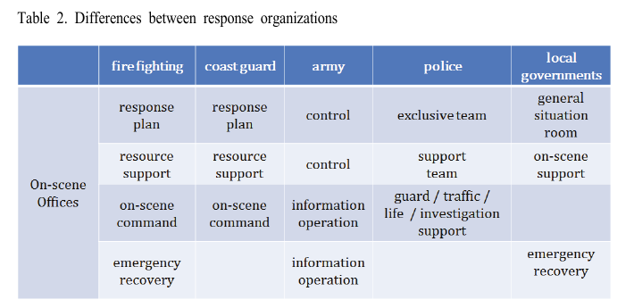

*원문 Table 2, 인쇄 p.42/PDF p.6. 캡션·행열·색상을 보존한 추출 이미지다. 표는 연구 당시의 기관별 비교이며 현재 조직도를 뜻하지 않는다.*

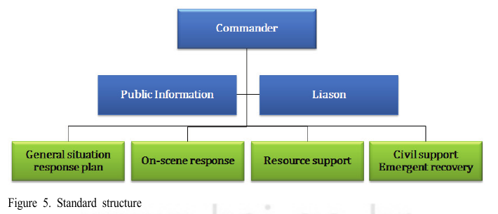

*원문 Figure 5, 인쇄 p.42/PDF p.6. 화살표·표제·배치를 보존했다. 공보·연락과 네 하위 기능을 묶은 연구의 제안 모형이다.*

이 제안은 ICS의 네 일반참모 기능을 한국 기관에 그대로 복사한 것이 아니다. 대민지원과 긴급복구를 포함해 국내 대응·수습 기능을 재구성했다. 따라서 **기능의 유사성과 조직·권한의 동일성을 구별**해야 한다. 연구는 SOP·통합지침·훈련 시나리오 등 후속 과제도 남긴다(p.44). 조직도를 제안했다는 사실과 실제 대응 성과가 검증되었다는 사실은 다르다. [학회 원문](https://journal.kci.go.kr/cemtp/archive/articleView?artiId=ART002190985).

### 3. 운영 연구: 조직도에 더해 무엇이 필요한가

**양기근·류상일(2013): 조직문화와 규범의 차이도 살피자.** 미국과의 직접 성과 비교가 아니라 통제단·대책본부 관계를 조직문화와 규범 인식에서 검토한 연구다. 설문 응답79명 중 전라지역78명이므로 전국 전체의 차이로 확대하기 어렵다. 저자들은 상호 접촉과 인사교류, 공동참여 훈련 등을 제안한다(pp.73–80).

이 연구에서 교재에 가져올 부분은 **조직 간 관계를 업무 규칙과 상호 이해의 문제까지 넓혀 보는 관점**이다. 다만 방법 절의 ‘긍정1→부정5’ 척도 설명과 큰 평균을 더 높은 문화 인식으로 읽는 본문의 방향이 어긋나므로, 어느 집단의 문화가 더 높다는 수치 해석은 보류한다. 원문 내부 충돌을 임의로 고쳐 새로운 결론을 만들지 않는다. [학회 원문](https://journal.kci.go.kr/cemtp/archive/articleView?artiId=ART001810057).

**채진·배영환(2019): 전문인력·협력·자원·예산을 함께 보자.** 소방공무원457명의 설문 응답으로 운영 관련 요인을 분석한 국내 연구다. 12개 독립변수를 넣은 모형에서 전문가 양성(β=.309), 유관기관 협력(.195), 자원지원(.117), 운영예산(.115)이 유의한 변수로 보고된다. Table 3의 순서는 이 모형의 표준화계수 크기를 비교한 결과다(p.133).

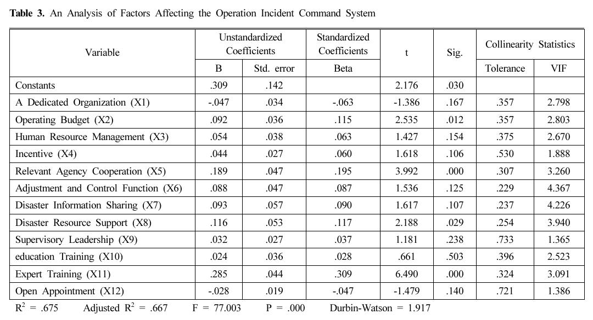

*원문 Table 3, 인쇄 p.133/PDF p.6. 변수·계수·유의확률·모형 통계량을 그대로 보존했다. 원문 .000은 확률이 실제로 0이라는 뜻으로 해석하지 않는다.*

이 결과는 **설문 인식 사이의 통계적 관계**다. 특정 정책을 시행하면 피해가 얼마나 줄어드는지, 예산을 어떤 비율로 배분해야 하는지를 보여주는 결과는 아니다. 전문가 양성과 일반 교육·훈련은 별도 변수이며, 후자가 이 모형에서 유의하지 않았다고 교육·훈련이 불필요하다고 결론내릴 수도 없다. 교재에서는 “각 기능을 맡을 사람이 실제로 준비되어 있고 협력·자원·예산이 뒷받침되는가?”라는 점검 질문으로 활용한다. [학회 논문·DOI](https://doi.org/10.7731/KIFSE.2019.33.3.128).

### 4. 과거 연구를 현재 제도와 연결하는 법

과거 연구의 진단을 읽은 뒤에는 관련 규정이 현재 어떻게 되어 있는지 다시 확인한다. 이번에 확인한 법 제50·52조에서는 다음을 구별할 수 있다.

- **설치와 단장:** 제50조는 시·도 소방본부와 시·군·구 소방서의 지역통제단 설치, 소방본부장·소방서장인 단장, 공조를 위한 직원 파견 요청을 규정한다.
- **지휘와 조건:** 제52조는 시·군·구통제단장의 긴급구조 지휘를 기본으로 하면서 시·도·중앙 단장의 직접 지휘 조건, 치안 관련 경찰 협의를 함께 둔다. 긴급구조 지휘를 모든 기관의 모든 권한을 통합하는 것으로 읽지 않는다.
- **지원·발표·연락:** 제6·7항의 협력과 지원 요청, 제8항의 지명된 발표자, 제9항의 현장지휘소·연락관 규정은 앞선 연구의 연결 과제를 현재 조문과 대조하는 근거다.
- **종료 협의:** 제10항은 긴급구조 활동 종료 때 참여한 관계 본부장 등과 협의하고 통보하도록 한다. 이를 조직도의 상자 하나가 다른 상자를 자동으로 지휘하게 되는 절차로 단순화하지 않는다.

이 규정들이 있다는 사실과 실제 현장에서 잘 작동한다는 평가는 다른 근거를 요구한다. **과거의 문제 제기 → 현재의 제도적 장치 → 실제 운영 기록**을 구별하면, 이미 생긴 규정을 없는 것처럼 설명하거나 규정의 존재만으로 문제 해결을 선언하는 오류를 줄일 수 있다. [제50조](https://www.law.go.kr/lsLawLinkInfo.do?chrClsCd=010202&lsJoLnkSeq=900596404) · [제52조](https://www.law.go.kr/LSW/lsLinkCommonInfo.do?chrClsCd=010202&lsJoLnkSeq=1031355015).

### 5. 수업 적용: 복합 현장을 세 개의 연결로 읽기

**가상 상황:** 공장 화재가 인근 지역의 대피와 다수 부상자 대응으로 확대되어 소방·경찰·지자체·의료기관이 함께 활동한다. 실제 사고를 재구성한 사례가 아니라, 이 절의 개념을 적용하기 위한 가정이다.

1. **지휘와 목표:** 긴급구조활동을 지휘하는 주체와 각 기관의 권한을 확인하고, 이번 작전기간에 달성할 공통 목표와 기관별 임무를 정리한다. 연락관에게 어떤 결정을 할 권한이 있는지도 확인한다.
2. **자원과 정보:** 필요한 자원을 어떤 경로로 요청할지, 이미 배정된 자원과 가용 자원을 어떻게 구별할지, 현장·지원조직 사이에서 어떤 정보를 갱신할지 정리한다.
3. **협력과 전환:** 인명구조와 현장 위험이 변할 때 누가 누구와 협의하고 어떤 기록을 넘겨야 하는지 묻는다. 긴급구조 종료와 다른 대응·복구 활동의 지속을 같은 시점으로 가정하지 않는다.

**복습 질문:** “통제단 조직도에 ICS와 비슷한 기능이 있다”는 설명만으로 충분한가? 권한의 범위, 공동 목표와 계획, 지원 요청·정보공유, 실제 수행 인력, 종료 협의에서 각각 추가로 확인할 항목을 하나씩 제시하라.

**답안의 방향:** 기능의 존재와 수행을 구별하고, 원문에 확인된 제도·연구 결과와 가상 상황에서 제안한 절차를 구별하면 된다. 특정 기관을 EOC나 Unified Command에 일대일로 대응시키는 답을 정답으로 고정하지 않는다.

### 6. 읽기 순서와 근거의 경계

먼저 [제3장의 ICS](https://dadem-nims-study.vercel.app/chapters/03/#ics)와 [EOC](https://dadem-nims-study.vercel.app/chapters/03/#eoc)를 읽고, 양기근(2008)의 역할·지원 관계, 윤용선 외(2016)의 공통 기능과 제안 편제, 두 운영 연구의 적용 조건 순으로 연결한다. 현재 조문은 연구의 시점 차이를 확인하는 별도 근거다. 네 연구의 결과를 미국 체계의 보편적 우월성이나 한국 통제단의 현재 실패를 증명하는 하나의 실증 결과로 합치지 않는다.

- 양기근(2008). 『사회과학연구』, 34(3), 81–104. DOI: 10.15820/khjss.2008.34.3.004.
- 윤용선·배상원·임상규(2016). 『Crisisonomy』, 12(12), 37–46. DOI: 10.14251/crisisonomy.2016.12.12.37.
- 양기근·류상일(2013). 『한국위기관리논집』, 9(9), 67–84. 조직문화·규범 인식의 보완 연구.
- 채진·배영환(2019). 『한국화재소방학회 논문지』, 33(3), 128–137. DOI: 10.7731/KIFSE.2019.33.3.128.
- 「재난 및 안전관리 기본법」 제50·52조. 2026-07-22 시행본, 2026-10-24 확인.
