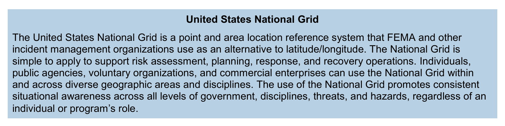

# NIMS 제4장 통신 및 정보관리(Communications and Information Management)

FEMA, *National Incident Management System*, Third Edition, October 2017. 인쇄 pp.50–59 / 발췌 PDF pp.2–11.

2026-10-17 재업로드 원문 11쪽을 직접 읽고 페이지 이미지로 대조한 한국어 학습용 정리다. 아래 비교표는 학습용 재구성이다. 본문에는 번호가 붙은 Figure·Table이 없으며 p.58의 USNG 설명 상자를 원문 이미지로 수록한다.

## 장의 전체 구조와 소목차별 핵심 주장 (pp.50–59)

교재의 원래 목차와 서술 순서를 임의로 재편하지 않고 인쇄 쪽수 순서대로 정리한 전체 구조다.

| 인쇄 쪽수 (PDF 쪽수) | 원문 대·중·소목차 | 핵심 개념 및 원문 주장 요약 | 생략되거나 압축된 설명 (심화 보완 포인트) | 보완 우선순위 |
| --- | --- | --- | --- | --- |
| **50** (p.2) | **IV. Communications and Information Management** (도입부) | • 목표: 상황인식 확립·유지, 접근성 보장, 음성·데이터 상호운용성 확보. • 책임 분담: 정보공유는 **모든 인원(all personnel)**의 책임, 통신시스템 지원은 **ICS 지원부서(Logistics Section)** 및 **EOC 지원/센터 지원 인력** 담당. • 상황인식 유지를 위해 정보의 수집(gathering)·대조정리(collating)·종합(synthesizing)·전파(disseminating)를 지속 수행. • 기획 요소: 정책, 장비, 데이터 아키텍처, 시스템, 표준, 훈련. | • `collating`(대조·분류·정리)과 `synthesizing`(종합)이 후반부 데이터 처리 절차(Validation·Analysis)와 어떻게 대응하는지 설명이 압축됨. • 왜 정보공유 책임과 통신시스템 관리 책임을 분리했는지 조직적 배경 생략. | 상 |
| **50–51** (pp.2–3) | **Key Principles** (4대 핵심 원칙 묶음) 1. *Interoperability* 2. *Reliability, Scalability, and Portability* 3. *Resilience and Redundancy* 4. *Security* | • **(1) 상호운용성(Interoperability):** 관할·조직 내외에서 음성·데이터·영상으로 실시간 소통. 계획에는 거버넌스, 표준운영절차(SOP), 기술, 훈련·연습, 평시 및 대형사고 활용 포함. • **(2) 신뢰성·확장성·이동성(Reliability, Scalability, Portability):** 모든 사고 유형(단일 관할/기관, 단일 관할 다기관, 다관할 다기관)에 작동. 평시 사용(regular use)이 익숙함·적용성·수용성·신기술 적응성·신뢰성을 높임. 확장성(Scalability)은 대응 규모와 시스템 사용자 수 확대 능력. 이동성(Portability)은 장비 통합·이동·배치뿐 아니라 **관할 간 무선 채널의 표준화된 할당(standardized assignment of radio channels)**을 통해 타 관할에서도 익숙한 장비를 쓰는 것을 포함. • **(3) 복원력·중복성(Resilience and Redundancy):** 중단 없는 정보 흐름 보장. 복원력(Resilience)은 인프라 손상·상실 후에도 견디며 계속 작동하는 능력. 중복성(Redundancy)은 서비스 복제(duplication of services)와 다양한 대체 수단을 통한 주 통신 손상 시 연속성 확보. • **(4) 보안(Security):** 민감 정보 보호, 산업제어시스템(industrial control systems) 등 핵심 자산 접근 보안, IT·보안 전문가 협력, 정보·수사(Intelligence/investigations) 인력의 민감정보·개인식별정보(PII)·기밀정보 보호, 데이터 보호·프라이버시 법 준수. | • 6개 세부 속성(상호운용성·신뢰성·확장성·이동성·복원력·중복성)과 보안을 왜 4개 묶음으로 제시했는지 설명 생략. • 상호운용성 계획의 다섯 요소를 실제 운영에서 어떻게 연결하는지는 추가 학습 과제임. • Portability에 무선 채널 표준 할당이 포함되는 기술적·제도적 이유 설명 필요. | 최상 |
| **52** (p.4) | **A. Communications Management** - *Standardized Communication Types* | • 4가지 표준 통신 유형:   1) **전략 통신(Strategic):** 고위급 지침, 자원 우선순위 결정, 역할·책임 결정, 전반적 사고관리 행동방침(courses of action).   2) **전술 통신(Tactical):** 현장 지휘부와 전술 인력, 협조 기관·조직 간 통신.   3) **지원 통신(Support):** 전략·전술 통신을 뒷받침하는 조정(병원 간 자원 주문·출동·추적, 교통·공공사업 통신 등).   4) **대국민 통신(Public):** 경보·경고(alerts and warnings), 기자회견. | • 제3장의 ICS·EOC·MAC Group·JIS/JIC 구조와 4가지 통신 유형이 각각 어떻게 맞물리는지 명시적 연결표가 없음. | 상 |
| **52–53** (pp.4–5) | - *Policy and Planning* - *Agreements* - *Equipment Standards* - *Training* | • **정책·계획(Policy and Planning):** 누가 어떤 시스템·플랫폼을 쓰는지, 환경별 필수 정보, 장비·시스템의 기술 변수 결정. NGO·민간·핵심인프라 소유자를 포함한 모든 이해관계자 참여. 비상운영계획(EOP)에 통합할 6가지 요소 제시(정보 수요와 출처, 파트너 정보 통합 지침·표준·도구, 경보·사고통지·대국민 통신 배포 절차·네트워크, 타 정부수준·파트너 통지 메커니즘, 지휘·조정·지원 통합 IT 프로토콜, 영어 제한자·장애인·접근 및 기능상 필요자 동시 접근 보장). • **협정(Agreements):** EOP 상 모든 당사자 간 사전 협정 체결(네트워크 연결, 데이터 형식 표준, 사이버보안 협정 포함). • **장비 표준(Equipment Standards):** 공통 인터페이스로 연결되며 상당수가 **민간 부문(private sector)의 운영 백본(operational backbone)**에 의존. 공공/민간 시스템 정기 개선·유지보수 필수. 표준 개발 시 4가지 고려사항(사용 환경 범위, 잠재 사용자 범위, 국가 공인 통신 표준[각주 19: ANSI, NFPA], 내구성 장비 필요성). • **훈련(Training):** 사고 전 상호운용 장비의 능력과 한계 숙지. | • 공공 재난통신망이 왜 민간 통신 백본에 의존하며, 그로 인한 취약성(상용망 마비·사이버 위협)을 왜 사전 협정(Agreements)과 표준으로 관리해야 하는지 맥락 보완 필요. | 중 |
| **54** (p.6) | **B. Incident Information** - *Incident Reports* - *Incident Action Plans* | • 사고정보의 6가지 활용 기능(계획 지원, 대국민 비상보호조치 소통, 사고 비용 산정, NGO·민간 자원 추가 참여 필요성 판단, 안전 문제 식별, 정보 요청 해결). • **사고보고서(Incident Reports):**   1) **상황보고서(Situation Reports, SITREP):** 정기적·반복적 발행, **지난 작전기간(past operational period)** 동안의 사고 상태 스냅샷, 확인·검증된(confirmed or verified) 구체적 세부사항(who, what, when, where, how) 수록.   2) **상태보고서(Status Reports):** 즉각보고(spot reports)를 예로 포함하며, 정기 SITREP 외에 중요·시간민감 정보 전달, 기능별(function-specific)·비격식적(less formal). • 보고서 표준화와 **보고 기관 고유 정보 수집·전파 허용**의 균형. • **사고대응계획(IAP):** IC/UC가 수립한 목표와 **계획된 작전기간(planned operational period, 통상 12~24시간)**의 전술 수록(세부 과정은 Appendix A, ICS Tab 8 참조). | • SITREP(과거 작전기간의 검증된 스냅샷)과 Status Report(비정기·시간민감·기능별), IAP(미래 12~24시간 계획된 작전기간의 목표·전술)의 시제·기능적 연결고리 설명 필요. | 최상 |
| **54–56** (pp.6–8) | - *Data Collection and Processing*   · *Initial Size-Up/Rapid Assessment*   · *Data Collection Plan*   · *Validation*   · *Analysis*   · *Dissemination*   · *Updating* | • 표준화된 표본추출(sampling)과 데이터 수집이 분석 신뢰성과 평가 품질을 높임. • 6대 표준 요소:   1) **초기 상황판단/신속평가(Initial Size-Up/Rapid Assessment):** 현장 최초 도착 책임자가 상황을 평가해 출동지령실(dispatch) 또는 지원조직에 전달 → 자원 배정·초기 의사결정에 활용.   2) **데이터 수집 계획(Data Collection Plan):** IC, UC, 또는 EOC 책임자(EOC director)가 수립. 수집할 **필수정보요소(Essential Elements of Information, EEI)**와 출처·방법·측정단위·수집일정을 정리한 매트릭스(matrix). **EEI는 데이터 수집 계획 수립 전에 먼저 정의**해야 함(14개 전형적 EEI 항목과 8가지 데이터 수집 방법 제시).   3) **검증(Validation):** 상황인식 담당 인력이 데이터가 불완전(incomplete)·부정확(inaccurate)·과장/윤색(embellished)·구식(outdated)·오도(misleading)되었는지 검토. 다양한 출처로 교차 검증.   4) **분석(Analysis):** 검증된 데이터를 의사결정에 유용한 정보(information)로 전환. 정보 수요를 더 작고 관리 가능한 요소로 분해해 해결. 시의적절·객관적 분석 및 **결측·미지 데이터(missing or unknown data) 인지** 강조.   5) **전파(Dissemination):** 수집·검증된 데이터를 관련 법률·정책에 맞춰 공유.   6) **갱신(Updating):** 지속적 모니터링·검증·통합·분석을 통해 상황인식 발전. | • 원문 데이터 흐름(Raw Data → Validated Data → Useful Information → Situational Awareness → Sound Decisions)의 단계별 병목과 오류 전파 메커니즘 심화 필요. • 왜 EEI를 수집 계획보다 먼저 정의해야 하는지(정보 과부하 방지) 설명 보완. | 최상 |
| **57–58** (pp.9–10) | **C. Communications Standards and Formats** - *Common Terminology, Plain Language, Compatibility*   · *Common Terminology*   · *Plain Language*   · *Data Interoperability* - *[Box] United States National Grid* | • **공통 용어(Common Terminology):** 서로 다른 분야·관할·조직·기관 간 소통과 조정 지원. • **평문(Plain Language):** 기관 고유 코드(codes)를 피하고 평문과 명료한 표현(clear text) 사용은 **공공 안전(public safety, 특히 대응인력과 피해 주민의 안전)** 문제임. 구두·서면 모든 조직 간 통신에 적용하며 기관 고유 약어·은어(acronyms or jargon) 지양. • **데이터 상호운용성(Data Interoperability):** 호환 가능한 정보관리의 3요소:   1) *Data Communication Protocols:* 음성·데이터·공간정보·인터넷·암호화 프로토콜, **국가정보교환모델(NIEM, `http://www.niem.gov`)** 일관 준수.   2) *Data Collection Protocols:* 사고 전 다분야·다관할 표준 절차 수립(예: **미국 국가격자망[USNG]** 활용).   3) *Encryption or Tactical Language:* 보안 유지를 위한 암호화 체계 구비. 대다수 사고에서는 평문이 적절하나, **진행 중인 테러 사건(ongoing terrorist event) 등 사고 성격상 전술 언어(tactical language)와 특수 암호화가 정당화되는 예외**가 있으며, 이 경우 **사고별 통신계획(incident-specific communications plan)**에 지침을 반영해야 함. • **[상자] USNG(p.58):** 위도/경도(latitude/longitude) 대안으로 쓰는 점·구역 위치 참조 체계. 위험평가·계획·대응·복구 전반 및 정부·민간·자원봉사조직 공통 활용. | • 소제목에는 `Compatibility`(호환성)가 있고 하위 항목 제목은 `Data Interoperability`(데이터 상호운용성)로 되어 있는 원문 구조의 관계 설명. • 평문 원칙과 암호화/전술 언어 예외의 경계 조건. | 상 |
| **58–59** (pp.10–11) | - *Technology Use and Procedures*   · *Social Media*   · *Using Social Media for Situational Awareness*   · *Using Social Media for Disseminating Information* - *Information Security/Operational Security* | • **기술 활용과 절차:** 사고 전·중·후 상황인식 제고 도구(무선·전화, 대중 경보·통지 시스템, GIS·사고관리 소프트웨어 등 하드웨어/소프트웨어/인터넷 기반 시스템, 소셜 미디어). 정보 공유 표준·절차·프로토콜 준수. • **소셜 미디어(Social Media):** 4가지 촉진 기능(사고 영향 및 현장 목격담[firsthand accounts] 모니터링·수집, 공공정보·경보 배포, 지도·사고 시각화 제작, 가용 정보·서비스·자원과 확인된 수요 매칭).   - *상황인식 활용:* 융합센터(fusion centers)·법집행·공중보건 등이 소셜 미디어 급증(spikes)이나 추세(trends)를 모니터링해 징후 조기 포착. **반드시 데이터 검증(validation) 절차를 거쳐 필터링·정확성 판단**.   - *정보전파 활용:* 지휘관이 고려할 3가지(대상 청중과 공유할 정보 유형 식별, 피드백·응답 요청 여부 결정, **생존자가 메시지를 받기까지의 잠재적 시간 지연[potential time delay]** 고려) → 플랫폼·빈도·메시지 구성·인력 배치 결정. 표준 공개 프로토콜과 접근성 준수. • **정보보안/작전보안(Information Security/Operational Security):** 기밀성(confidentiality) 요구가 정보공유를 복잡하게 만들 수 있음(특히 법집행 공동체 내부 및 비상관리·소방·공중보건 등 타 공동체와 첩보[intelligence] 공유 시). 제한·기밀정보 접근은 **관련 법령(applicable law)**, 개인의 **보안인가 등급(security clearance)**, **알 필요성(need to know)**에 따름. | • 소셜 미디어의 양방향성(수집 vs 전파)에서 발생하는 허위정보 검증 문제와 생존자 수신 지연 문제. • 정보공유(Information Sharing) 원칙과 정보/작전보안(Need to know) 사이의 구조적 긴장. | 상 |

---

## 핵심 원칙과 세부 내용 정리

### 1. 정보공유와 통신체계의 역할 분담 (p.50)

- **최상위 목적:** 정확하고(accurate), 시의적절하며(timely), 관련성 있는(relevant) 정보를 확보·제공하여 **상황인식(Situational Awareness)**을 확립·유지하고, **접근성(accessibility)** 및 **음성·데이터 상호운용성(voice and data interoperability)**을 보장한다.
- **책임의 이중 구조:**
  1. **정보공유(Information Sharing):** 현장에 있든, EOC에 있든, 다른 지원 거점에 있든 **모든 사고 대응인력(all personnel)**의 책임이다.
  2. **정보공유를 지원하는 통신시스템(Communications Systems):** 통상 **ICS의 지원부서(Logistics Section)** 인력과 **EOC의 지원 또는 센터 지원 인력(logistics or center support staff)**이 담당한다.
- **지속적 정보 순환(Continual Information Flow):** 대응인력은 사고 정보를 지속적으로 **수집(gathering) → 대조·정리(collating) → 종합(synthesizing) → 전파(disseminating)**하여 상황인식을 유지한다.
- **사전 기획 대상:** 사고 관련 정책(policies), 장비(equipment), 데이터 아키텍처(data architecture), 시스템(systems), 표준(standards), 훈련(training).

### 2. 통신 및 정보관리의 4대 핵심 원칙 (pp.50–51)

원문은 사고관리자가 사고 중 끊임없는 정보 흐름(constant flow of information)을 유지하도록 돕는 핵심 원칙을 4개 범주(세부 7개 개념)로 제시한다.

| 원문 번호 | 원칙 범주 | 핵심 정의 및 작동 요건 | 원문 쪽수 |
| --- | --- | --- | --- |
| **(1)** | **상호운용성(Interoperability)** | • 관할구역 및 조직 **내부(within)와 상호 간(across)**에 음성·데이터·영상 시스템으로 **실시간(in real time)** 소통할 수 있게 하는 능력. • 상호운용성 계획(Interoperability plans)의 5대 구성요소: ① 거버넌스(governance), ② 표준운영절차(standard operating procedures, SOP), ③ 기술(technology), ④ 훈련 및 연습(training and exercises), ⑤ 대형 사고뿐 아니라 **일상 작전(routine operations)에서의 사용(usage)**. | p.50 |
| **(2)** | **신뢰성(Reliability)** | • 모든 유형의 사고(단일 관할·단일 기관, 단일 관할·다기관, 다관할·다기관)에서 기능할 수 있어야 함. • **평시 정기적 사용(regular use)**을 통해 사용자에게 익숙하고(familiar), 적용 가능하며(applicable), 수용 가능하고(acceptable), 신기술에 쉽게 적응하며(readily adaptable), 어떤 상황에서도 신뢰할 수 있게 보장함. | p.50 |
| **(2)** | **확장성(Scalability)** | • 다수의 관할·조직에서 온 수많은 대응·지원 인력이 참여하는 대형 사고나 복수 사고를 포함해, 어떤 상황도 지원할 수 있도록 시스템을 확장할 수 있고 **시스템 상의 사용자 수(number of users)를 쉽게 늘릴 수 있음**. | p.50 |
| **(2)** | **이동성(Portability)** | • 휴대 가능한 기술·장비를 통해 통신시스템의 효과적인 통합(integration), 운송(transport), 배치(deployment)를 보장함. • 단순한 물리적 휴대성을 넘어 **관할구역 간 무선 채널의 표준화된 할당(standardized assignment of radio channels across jurisdictions)**을 포함하며, 이를 통해 대응인력이 자기 관할 밖의 사고에 참여하더라도 **익숙한 기존 장비(familiar equipment)**를 그대로 사용할 수 있게 함. | p.51 |
| **(3)** | **복원력(Resilience)** | • 기반시설의 손상이나 상실(damage or loss of infrastructure) 이후에도 시스템이 **견뎌내고 계속 작동하는 능력(ability of systems to withstand and continue to perform)**. | p.51 |
| **(3)** | **중복성(Redundancy)** | • **서비스의 복제(duplication of services)**를 통해 달성됨. • 주 통신 기능(primary communications capabilities)이 손상을 입었을 때 **다양한 대체 수단(diverse alternative methods)**을 통해 통신의 연속성(continuity of communication)을 가능하게 함. | p.51 |
| **(4)** | **보안(Security)** | • 사고 대응인력 간에 소통되는 민감 정보(sensitive information)와 침해 시 광범위한 영향을 초래할 수 있는 **산업제어시스템(industrial control systems)** 등 핵심 자산(critical assets)에 대한 접근을 보호함. • IT 및 보안 전문가와 협력해 데이터·네트워크·시스템 보호 모범사례(best practices)를 통합. • 정보·수사 기능(Intelligence/investigations function) 인력이 다루는 민감정보, **개인식별정보(personally identifiable information, PII)**, 기밀정보(classified information)를 관련 법률에 따라 보호하고 데이터 보호·프라이버시 법률을 준수함. | p.51 |

---

## A. 통신관리(Communications Management, pp.52–53)

### 1. 표준화된 통신 유형(Standardized Communication Types, p.52)

서로 다른 분야·관할·조직·기관의 대응인력이 효과적으로 소통하기 위해 사용하는 4가지 표준 통신 유형이다.

| 통신 유형 | 원문 정의 및 포함 내용 | 인쇄 쪽수 |
| --- | --- | --- |
| **전략 통신(Strategic)** | 고위급 지침(high-level directions): 자원 우선순위 결정(resource priority decisions), 역할과 책임 결정(roles and responsibilities determinations), 전반적인 사고관리 행동방침(overall incident management courses of action) 포함. | p.52 |
| **전술 통신(Tactical)** | 현장 지휘부(on-scene command)와 전술 인력(tactical personnel), 그리고 협조 기관·조직(cooperating agencies and organizations) 간의 통신. | p.52 |
| **지원 통신(Support)** | 전략 및 전술 통신을 뒷받침하는 조정(coordination in support of strategic and tactical communications). • 원문 예시: 자원 주문·출동·추적에 관한 병원 간(among hospitals) 통신, 교통(traffic) 및 공공사업(public works) 통신. | p.52 |
| **대국민 통신(Public)** | 경보 및 경고(alerts and warnings), 기자회견(press conferences). | p.52 |

### 2. 정책 및 계획(Policy and Planning, pp.52–53)

- **기획의 결정 사항:** 사용할 통신 시스템·플랫폼, 사용 권한자(who can use them), 환경별 필수 정보, 모든 장비·시스템의 기술적 매개변수(technical parameters) 등. 기술 변화와 정보교환 방식 개선에 맞춰 계획·절차도 진화해야 한다.
- **이해관계자 참여:** 비정부기구(NGO), 민간 부문(private sector), 핵심 기반시설 소유자(critical infrastructure owners)를 포함한 **모든 이해관계자(all stakeholders)**가 통신 계획·전략 수립에 참여해야 하며, 기술·장비 표준도 공유해 상호운용성을 높인다.
- **비상운영계획(EOP) 등에 포함해야 할 6가지 요소(pp.52–53):**
  1. 정보 수요(information needs)와 잠재적 정보 출처(potential sources)
  2. 파트너 조직과 정보를 통합하기 위한 지침·표준·도구
  3. 경보, 사고 통지(incident notifications), 대국민 통신 및 기타 핵심 정보를 배포하기 위한 절차·프로토콜·네트워크
  4. 다른 정부 수준(other levels of government) 및 파트너 조직에 통지하기 위한 메커니즘과 프로토콜
  5. 모든 지휘·조정·지원 기능을 통합하기 위해 정보관리 기술(컴퓨터, 네트워크, 정보공유 메커니즘 등)을 효과적·효율적으로 사용하는 프로토콜
  6. 영어 능력이 제한된 사람(limited proficiency in English), 장애인(disabilities), 기타 접근 및 기능상 필요가 있는 사람(access and functional needs)을 포함해 **모든 사람에게 사고 메시지가 동시에 접근 가능(simultaneously accessible)하도록 보장**하는 지침과 메커니즘

### 3. 협정(Agreements), 장비 표준(Equipment Standards), 훈련(Training) (p.53)

- **협정(Agreements):** 관할구역의 비상운영계획(EOP)에 명시된 모든 당사자는 사고 발생 시 계획·절차의 통신 요소가 즉시 효력을 발휘하도록 사전 협정을 체결해야 한다. 협정에는 합의된 통신 시스템·플랫폼, **네트워크 연결(connection of networks)**, **데이터 형식 표준(data format standards)**, **사이버보안 협정(cybersecurity agreements)**이 포함된다.
- **장비 표준(Equipment Standards):** 사고관리 통신장비는 공통 인터페이스(common interfaces)로 연결된 구성요소·시스템으로 이루어지며, **상당수가 운영 백본(operational backbone)을 민간 부문(private sector)에 의존**한다. 공공/민간 통신시스템과 장비는 정기적으로 개선·갱신·유지보수해야 한다. 표준 개발 시 고려할 4가지 사항:
  1. 인력이 시스템을 사용할 **환경 조건의 범위(range of conditions)**
  2. 잠재적으로 시스템을 사용할 **인력의 범위(range of personnel)**
  3. **현행 국가 공인 통신 표준(current nationally recognized communications standards)** — **각주 19:** 미국표준협회(American National Standards Institute, ANSI)와 미국방화협회(National Fire Protection Association, NFPA) 같은 표준개발기구(Standards-developing organizations)가 통신 표준을 정기적으로 갱신·발행함.
  4. **내구성 있는 장비(durable equipment)**의 필요성
- **훈련(Training):** 상호운용 가능한 시스템과 장비를 활용한 훈련·연습을 통해 사고 전에 그 능력과 한계(capabilities and limitations)를 이해하게 한다.

---

## B. 사고정보(Incident Information, pp.54–56)

### 1. 사고정보의 6가지 활용 목적 (p.54)

사고 중 ICS, EOC, MAC Group, JIS 내부의 여러 기능에서 의사결정을 위해 시의적절하고 정확한 정보를 다음 용도로 사용한다.

1. 계획 수립 지원(Aiding in planning)
2. 비상보호조치(emergency protective measures)를 포함한 대국민 소통(Communicating with the public)
3. 사고 비용 산정(Determining incident cost)
4. NGO 또는 민간 부문 자원의 추가 참여 필요성 판단(Determining the need for additional involvement of NGO or private sector resources)
5. 안전 문제 식별(Identifying safety issues)
6. 정보 요청 해결(Resolving information requests)

### 2. 사고보고서(Incident Reports)와 사고대응계획(IAP) 비교 (p.54)

| 구분 | 상황보고서(Situation Reports, SITREP) | 상태보고서(Status Reports) | 사고대응계획(Incident Action Plans, IAP) |
| --- | --- | --- | --- |
| **성격 및 발행 주기** | 정기적·반복적(regular and recurring basis)으로 작성·배포되는 공식 사고 상세 보고서 | 정기 SITREP 일정 외에 긴급·수시로 작성되는 보고서(예: **즉각보고[spot reports]**). SITREP보다 비격식적(less formal) | IC 또는 UC가 수립한 사고 목표와 전술을 담은 대응 계획 문서 |
| **시간적 초점** | **지난 작전기간(past operational period)** 동안의 사고 상태 스냅샷(snapshot) | 현재 발생한 중요하거나 시간에 민감한(vital and/or time-sensitive) 정보 | **계획된 작전기간(planned operational period, 통상 12~24시간)** 동안의 목표와 전술 |
| **핵심 내용** | 사고와 관련된 구체적 세부사항(**who, what, when, where, and how**)에 대한 **확인되거나 검증된 정보(confirmed or verified information)** | 통상 **특정 기능 중심(function-specific)**의 긴급 현황 정보 | 사고 목표(incident objectives) 및 계획된 작전기간에 수행할 전술(tactics) (상세 과정은 Appendix A, ICS Tab 8 참조) |
| **표준화와 예외 원칙** | 관할·조직 내외에서 사고 통지·상황·상태 보고서의 정보를 표준화하면 정보처리가 촉진되고 타 기관이 정보를 예측·신속 탐색·행동할 수 있음. **단, 표준화가 보고 조직 고유의 정보(information unique to a reporting organization)를 수집·전파하는 것을 막아서는 안 됨.** | 좌동 | 상황인식을 높이고 사고 목표·전술을 더 잘 이해하도록 지원 |

### 3. 데이터 수집 및 처리(Data Collection and Processing) 6대 표준 요소 (pp.54–56)

대응인력은 표준 데이터 수집 기법과 정의(standard data collection techniques and definitions)를 준수해 데이터를 수집·분석·공유해야 하며, **표준화된 표본추출(standardized sampling)과 데이터 수집**이 신뢰할 수 있는 분석과 평가 품질 향상을 가능하게 한다(p.54). ICS, EOC, MAC Group 리더와 공보(public affairs) 인력 모두가 의존하는 데이터 수집·처리의 6대 표준 요소는 다음과 같다(pp.55–56).

| 요소 | 원문 명칭 | 수행 주체 및 핵심 작동 내용 | 원문 쪽수 |
| --- | --- | --- | --- |
| **1** | **초기 상황판단 / 신속평가** (Initial Size-Up/Rapid Assessment) | • **현장에 가장 먼저 도착한 책임자(official who is the first to arrive at the scene)**가 상황을 평가함. • 평가 결과를 출동지령실(dispatch) 또는 기타 사고 지원 조직에 전달 → 해당 조직 인력이 이를 활용해 **자원을 배정(assign resources)**하고 기타 사고 관련 의사결정을 내림. | p.55 |
| **2** | **데이터 수집 계획** (Data Collection Plan) | • **IC, UC, 또는 EOC 책임자(EOC director)**가 반복적인 사고정보 수집 과정을 표준화하기 위해 수립 가능. • 통상 **필수정보요소(Essential Elements of Information, EEI — 정보에 입각한 의사결정에 필요한 정보 항목)**를 정리한 **매트릭스(matrix)** 형태이며, 항목별 **출처(sources), 방법(methods), 측정단위(units of measure), 수집일정(schedules)**을 명시함. • **핵심 선후관계:** 데이터 수집 계획을 수립하기 **전에(prior to)** EEI를 먼저 정의해야 함. | p.55 |
| **3** | **검증** (Validation) | • **상황인식 담당 인력(staff responsible for situational awareness)**이 데이터를 검토함. • 데이터가 **불완전(incomplete), 부정확(inaccurate), 과장/윤색(embellished), 구식(outdated), 또는 오도(misleading)**되었는지 판단. • 데이터를 검증하기 위해 **다양한 출처(a variety of sources)**를 사용해야 함. | p.56 |
| **4** | **분석** (Analysis) | • 상황인식 담당 인력이 **검증된 데이터(validated data)**를 분석해 사고관리상의 함의(implications)를 파악하고, **원시 데이터(raw data)를 의사결정에 유용한 정보(information that is useful for decision making)로 전환**함. • 사고의 정보 수요를 **더 작고 관리 가능한 요소(smaller, more manageable elements)**로 분해하여 해결함. • 문제와 상황에 대한 철저한 이해에 기반해 시의적절하고 객관적인 분석을 제공하며, **결측되거나 알려지지 않은 데이터(missing or unknown data)를 인지(cognizant)**해야 함. | p.56 |
| **5** | **전파** (Dissemination) | • 데이터를 수집·검증한 후, **관련 데이터 전파 법률 및 정책(applicable data dissemination laws and policies)**에 부합하게 타인과 공유함. • 목표: 시의적절하고 정확한 전파를 통해 **상황인식을 높이고 효과적인 조정을 촉진**함. | p.56 |
| **6** | **갱신** (Updating) | • 데이터와 정보의 관련 요소를 지속적으로 **모니터링(monitoring), 검증(verifying), 통합(integrating), 분석(analyzing)**하여 상황인식을 발전시키고 건전한 의사결정(sound decisions)을 지원함. | p.56 |

> **표준 요소와 고정 절차의 구별**
> 원문 p.55는 여섯 가지를 표준 요소(standard elements)로 열거한다. 표의 번호는 설명을 위한 순번이며, 모든 사고에서 각 요소를 한 번씩만 순서대로 완료하라는 명시적 규정이 아니다. 특히 갱신(Updating)은 지속적인 모니터링·검증·통합·분석을 포함한다(p.56).

#### 필수정보요소(EEI)의 전형적 예시 14항목과 데이터 수집 방법 8가지 (pp.55–56)

원문 p.55의 EEI 목록은 전형적 예시(typically includes items such as)다. 모든 사고에서 14항목을 전부 수집하라는 의무 목록도, 이 항목들로만 제한한 완결 목록도 아니다. p.56의 수집 방법 8가지 역시 다양한 방법의 예시다. 계획 수립 권한은 IC·UC·EOC 책임자가 수립할 수 있다(may establish)는 표현이며, EEI를 정한 뒤 계획을 만든다는 선후관계와 구별한다.

| 구분 | 원문 목록 (전수 추출) |
| --- | --- |
| **EEI 전형적 예시 14항목** (p.55) | 1. 사고 구역 경계 및 진입 지점(Incident area boundaries/access points) 2. 관할구역 경계(Jurisdictional boundaries) 3. 사회적·경제적·정치적 영향(Social/economic/political impacts) 4. 주민 건강에 미치는 영향(Impact to health of the population) 5. 교통 시스템 상태(Transportation system status) 6. 통신 시스템 상태(Communications system status) 7. 위험요인별 특화 정보(Hazard-specific information) 8. 주요 기상(Significant weather) 9. 지진 또는 기타 지구물리 데이터(Seismic or other geophysical data) 10. 핵심 시설 상태(Critical facility status) 11. 항공 정찰 활동 상태(Aerial reconnaissance activity status) 12. 재난/비상 선포 상태(Disaster/emergency declaration status) 13. 계획되었거나 예정된 활동(Planned or upcoming activities) 14. 기부·기증(Donations; 물품으로만 한정하지 않음) |
| **데이터 수집 방법 8가지** (p.56) | 1. 공공안전 통신요원(public safety telecommunicators)이 받은 **911 신고** 또는 출동지령 시스템(dispatch systems)에서 데이터 확보 2. 대응인력 간 **무선·영상·데이터 통신 모니터링** 3. **상황보고서(SITREPs)** 열람 4. 미국 기상청(National Weather Service) 대표 등 **기술전문가(technical specialists)** 활용 5. 현장 관찰자(field observers), ICP, Area Command, MAC Group, DOC, 타 EOC로부터 **보고 수신** 6. EOC, 기타 시설, 현장 작전사무소(operational field offices)에 **정보전문가(information specialists) 배치** 7. 관련 **공간정보 산출물(geospatial products)** 분석 8. 인쇄물, 온라인, 방송, **소셜 미디어(social media)** 모니터링 |

---

## C. 통신 표준 및 형식(Communications Standards and Formats, pp.57–59)

### 1. 공통 용어, 평문, 데이터 상호운용성 (pp.57–58)

- **공통 용어(Common Terminology, p.57):** 서로 다른 분야·관할·조직·기관의 대응인력이 소통하고 활동을 효과적으로 조정하도록 돕는다.
- **평문(Plain Language, p.57):**
  - 사고관리에서 기관 고유 코드(codes)를 피하고 **평문(plain language)과 명료한 표현(clear text)**을 사용하는 것은 **공공 안전(public safety)**, 특히 사고 대응인력과 사고 피해 주민의 안전 문제다.
  - 사고 중 조직 요소 간 **모든 구두 및 서면(oral or written) 통신**에 평문을 사용해야 하며, 다관할·다조직 참여 사고에서는 특정 기관·조직·관할 고유의 **약어나 은어(acronyms or jargon)** 사용을 피해야 한다.
- **데이터 상호운용성(Data Interoperability, p.57):** 관리·지휘·지원 요소 및 협조 관할·조직 간 정보 전파를 가능하게 하는 호환 가능한 정보관리(compatible information management)의 3가지 요소:
  1. **데이터 통신 프로토콜(Data Communication Protocols):** 음성, 데이터, 공간정보, 인터넷 사용, 데이터 암호화를 포함한 통신 절차·프로토콜. **국가정보교환모델(National Information Exchange Model, NIEM, `http://www.niem.gov`)**과 일관되게 정보를 구조화·공유하는 것을 포함한다.
  2. **데이터 수집 프로토콜(Data Collection Protocols):** 사고 전에 **미국 국가격자망(United States National Grid, USNG)** 사용 같은 다분야·다관할 절차·프로토콜을 수립해 표준화된 데이터 수집·분석을 가능하게 한다.
  3. **암호화 또는 전술 언어(Encryption or Tactical Language):** 보안 유지를 위해 필요 시 정보를 암호화하는 방법론과 시스템을 갖춰야 한다. **대부분의 사고에서는 평문이 적절하지만, 진행 중인 테러 사건(ongoing terrorist event) 등 사고의 성격에 따라 전술 언어(tactical language)가 정당화되는 경우가 간혹 있다.** 이러한 경우 특수 암호화와 전술 언어의 적절한 사용 지침을 **사고별 통신계획(incident-specific communications plan)**에 포함해야 한다.

> **평문과 암호화는 다른 문제**
> 이 노트에서 평문(Plain Language)은 상대방이 이해할 수 있는 알기 쉬운 표현을 뜻한다. 이를 비암호화 전송으로 풀이하거나, 모든 암호화(Encryption)를 금지한다고 읽으면 안 된다. 원문 p.57은 필요한 정보의 암호화와, 사고 성격상 정당화되는 전술 언어(Tactical Language)의 사용을 구별해 기술한다. 진행 중인 테러 사건은 후자의 예시이며 자동 허용 조건이 아니다.

### 원문 시각 요소 — United States National Grid (인쇄 p.58 / PDF p.10)

*원문 인쇄 p.58 / PDF p.10 상단 강조 상자(Callout Box). 원문 시각 요소를 240dpi PNG로 그대로 추출했다.*

- **USNG 핵심 내용(p.58):** FEMA와 기타 사고관리 조직이 **위도/경도(latitude/longitude)의 대안**으로 사용하는 **점 및 구역 위치 참조 시스템(point and area location reference system)**이다. 위험평가, 계획, 대응, 복구 작전을 지원하는 데 간단히 적용할 수 있으며, 개인·공공기관·자원봉사조직·민간기업이 다양한 지리적 구역과 분야를 가로질러 사용할 수 있다. 개인이나 프로그램의 역할에 관계없이 모든 정부 수준·분야·위협·위험에 걸쳐 일관된 상황인식을 촉진한다.

### 2. 기술 활용과 절차 및 소셜 미디어(Technology Use and Procedures & Social Media, pp.58–59)

- **기술 도구 예시 4가지(p.58):** ① 무선 및 전화 시스템, ② 대중 경보·통지 시스템, ③ 하드웨어·소프트웨어·인터넷 기반 시스템 및 애플리케이션(**지리/공간정보시스템[GIS]** 및 사고관리 소프트웨어 포함), ④ 소셜 미디어(Social media).
- **소셜 미디어의 4가지 촉진 기능(p.58):**
  1. 사고 영향에 관한 정보와 **현장 목격담(firsthand accounts)** 모니터링 및 수집
  2. 공공정보 및 경보 배포
  3. 지도 및 사고 시각화(incident visualizations) 제작
  4. 가용 정보·서비스·자원을 확인된 수요(identified needs)와 매칭
- **상황인식을 위한 소셜 미디어 활용(p.58):** 융합센터(fusion centers), 법집행, 공중보건 또는 기타 정보 모니터링 시스템이 소셜 미디어의 **급증(spikes)이나 추세(trends)**를 모니터링하여 상황인식을 높이거나 신종 이슈의 조기 징후(early indication of emerging issues)를 포착할 수 있다. **다른 모든 데이터와 마찬가지로 데이터 검증(data validation) 절차를 사용해 소셜 미디어 정보의 정확성을 필터링하고 판단해야 한다.**
- **정보 전파를 위한 소셜 미디어 활용(p.59):** 사고관리자가 고려해야 할 3가지 핵심 사항:
  1. **의도한 대상 청중(intended audiences)**과 공유할 정보 유형 식별
  2. **피드백이나 응답을 요청할지 여부(whether they wish to solicit feedback or responses)** 결정
  3. **생존자가 메시지를 수신하기까지의 잠재적 시간 지연(potential time delay before survivors receive the message)**
  - 이 결정들을 바탕으로 사용할 플랫폼, 메시지 빈도와 구성(frequency and configuration), 임무 배정 및 인력 수요(assignments and staffing needs)를 결정하며, 표준 공개 프로토콜과 접근성을 준수해야 한다.

### 3. 정보보안 및 작전보안(Information Security/Operational Security, p.59)

- **기밀성과 정보공유의 긴장:** 기밀성(confidentiality)에 대한 요구는 때때로 정보공유를 복잡하게 만든다. 특히 법집행 공동체(law enforcement community) 내부에서, 그리고 법집행 공동체가 비상관리·소방·공중보건 및 기타 공동체와 **첩보(intelligence)**를 공유할 때 두드러진다.
- **접근 통제의 3대 기준:** 특정 제한정보(restricted information) 또는 기밀정보(classified information)에 대한 접근은 다음 세 가지에 달려 있다.
  1. **관련 법률(applicable law)**
  2. 개인의 **보안인가 등급(security clearance)**
  3. **알 필요성(need to know)**

---

## 원문 용어와 학습용 약어 및 표준기관 목록 (pp.50–59)

| 약어 | 영문 원어 | 한국어 명칭 | 등장 쪽수 | 비고 |
| --- | --- | --- | --- | --- |
| **NIMS** | National Incident Management System | 국가재난관리시스템(국가사고관리체계) | 표지, 각 쪽 상단 | 제3판(2017년 10월) |
| **ICS** | Incident Command System | 사고지휘체계 | p.50, 54, 55 | 원문 본문에는 약어로 등장(제3장에서 정의) |
| **EOC** | Emergency Operations Center | 비상운영센터 | p.50, 51, 54, 55, 56 | 원문 본문에는 약어로 등장 |
| **SOP** | Standard Operating Procedures | 표준운영절차 | p.50 | 상호운용성 계획의 구성요소 |
| **IT** | Information Technology | 정보기술 | p.51 | 원문 본문에는 약어로 등장 |
| **NGO** | Nongovernmental Organization | 비정부기구 | p.52, 54 | 원문 본문에는 약어로 등장 |
| **ANSI** | American National Standards Institute | 미국표준협회 | p.53 (각주 19) | 표준개발기구(SDO) 예시 |
| **NFPA** | National Fire Protection Association | 미국방화협회 | p.53 (각주 19) | 표준개발기구(SDO) 예시 |
| **MAC Group** | Multiagency Coordination Group | 다기관조정그룹 | p.54, 55, 56 | 원문 본문에는 약어로 등장 |
| **JIS** | Joint Information System | 합동정보시스템 | p.54 | 원문 본문에는 약어로 등장 |
| **SITREP** | Situation Report | 상황보고서 | p.54, 56 | 정기·반복 발행, 지난 작전기간의 검증된 스냅샷 |
| **IAP** | Incident Action Plan | 사고대응계획 | p.54 | 계획된 작전기간(통상 12~24시간)의 목표·전술 |
| **EEI** | Essential Elements of Information | 필수정보요소 | p.55 | 정보에 입각한 의사결정에 필요한 핵심 정보 항목 |
| **ICP** | Incident Command Post | 현장지휘소 | p.56 | 데이터 수집 보고 출처 중 하나로 등장 |
| **DOC** | Departmental Operations Center | 부서운영센터 | p.56 | 데이터 수집 보고 출처 중 하나로 등장 |
| **NIEM** | National Information Exchange Model | 국가정보교환모델 | p.57 | `http://www.niem.gov` |
| **USNG** | United States National Grid | 미국 국가격자망 | p.57, 58 | 원문은 약어 없이 풀네임 또는 National Grid로 표기 |
| **GIS** | Geographic/Geospatial Information Systems | 지리/공간정보시스템 | p.58 | 원문에서 두 원어를 병기함 |

*(참고: 개인식별정보 `personally identifiable information`[p.51], 비상운영계획 `emergency operations plan`[pp.52–53]은 원문 본문에서 영문 소문자 풀네임으로만 등장하며 `PII`, `EOP` 약어 표기는 원문에 직접 등장하지 않는다.)*

---
