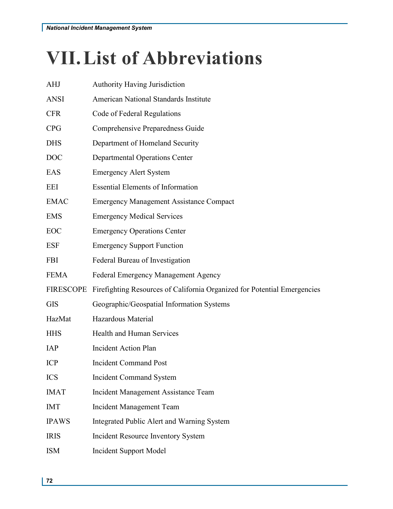
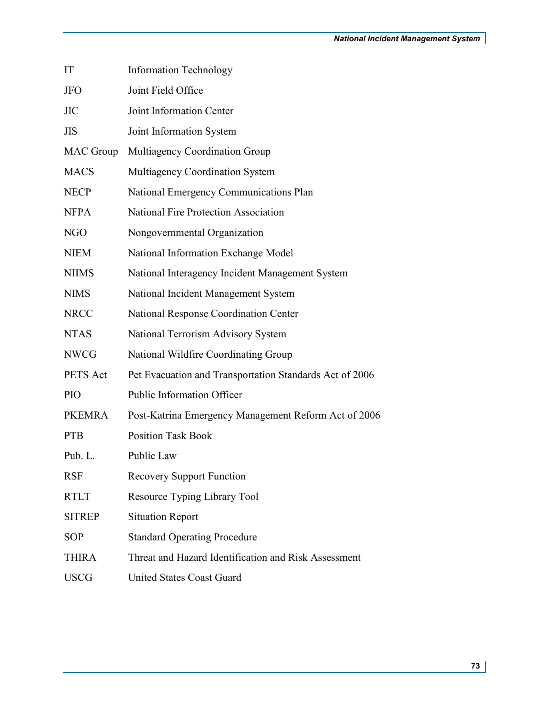

# 제7장 약어 목록(List of Abbreviations)

## 원문 범위와 읽는 방법

제7장 약어 목록(List of Abbreviations)은 약어와 영문 확장형을 대응시키는 목록이다. 제공 PDF는 표지 없는 본문 2쪽이며 **인쇄 p.72/PDF p.1에 26개, 인쇄 p.73/PDF p.2에 26개, 총 52개**다. 약어와 영문 확장형의 순서·대소문자·공백·구두점·단복수를 원문과 대조했다.

한국어 번역과 A–F 분류는 학습용 제안이며 공식 한국어 명칭·FEMA 공식 분류가 아니다. 목록 자체는 용어의 상세 정의·역사·법적 권한·기관 간 관계·현재 도구 운영 현황을 제공하지 않는다.

기존 제6장에는 사용자 제공 대역 HTML의 AHJ–ISM26개가 있다. 이번 원문은 그26개에 IT–USCG26개를 더한 전체52개다. 기존 대역과 개별 링크는 보존하고 제7장의 원문 대조 목록으로 보완한다. 같은26개를 서로 독립적인 증거52개로 합산하지 않는다.

## 인쇄72쪽: AHJ–ISM26개

다음 한국어 표는 원문 목록의 구조화와 학습용 번역이다. 원래 배치는 뒤의 원문 페이지 이미지에서 확인할 수 있다.

| 번호 | 약어 | 원문 영문 확장형 | 학습용 한국어 | 개념군 |
| --- | --- | --- | --- | --- |
| 1 | AHJ | Authority Having Jurisdiction | 관할 권한기관 | D |
| 2 | ANSI | American National Standards Institute | 미국 국가표준협회 | F |
| 3 | CFR | Code of Federal Regulations | 미국 연방규정집 | F |
| 4 | CPG | Comprehensive Preparedness Guide | 종합 대비 지침 | E |
| 5 | DHS | Department of Homeland Security | 미국 국토안보부 | A |
| 6 | DOC | Departmental Operations Center | 부처·기관 운영센터 | B |
| 7 | EAS | Emergency Alert System | 비상경보시스템 | C |
| 8 | EEI | Essential Elements of Information | 필수 정보요소 | C |
| 9 | EMAC | Emergency Management Assistance Compact | 비상관리지원협약 | D |
| 10 | EMS | Emergency Medical Services | 응급의료서비스 | D |
| 11 | EOC | Emergency Operations Center | 비상운영센터 | B |
| 12 | ESF | Emergency Support Function | 긴급지원기능 | D |
| 13 | FBI | Federal Bureau of Investigation | 미국 연방수사국 | F |
| 14 | FEMA | Federal Emergency Management Agency | 미국 연방재난관리청 | A |
| 15 | FIRESCOPE | Firefighting Resources of California Organized for Potential Emergencies | 캘리포니아 잠재적 비상상황 대비 소방자원 조직화체계 | A |
| 16 | GIS | Geographic/Geospatial Information Systems | 지리·공간정보시스템 | C |
| 17 | HazMat | Hazardous Material | 유해물질 | D |
| 18 | HHS | Health and Human Services | 보건·복지(원문 명칭 직역) | F |
| 19 | IAP | Incident Action Plan | 사고대응계획 | E |
| 20 | ICP | Incident Command Post | 현장지휘소 | B |
| 21 | ICS | Incident Command System | 사고지휘체계 | B |
| 22 | IMAT | Incident Management Assistance Team | 사고관리지원팀 | B |
| 23 | IMT | Incident Management Team | 사고관리팀 | B |
| 24 | IPAWS | Integrated Public Alert and Warning System | 통합 대국민 경보·경고시스템 | C |
| 25 | IRIS | Incident Resource Inventory System | 사고자원목록시스템 | D |
| 26 | ISM | Incident Support Model | 사고지원모형 | B |

## 인쇄73쪽: IT–USCG26개

| 번호 | 약어 | 원문 영문 확장형 | 학습용 한국어 | 개념군 |
| --- | --- | --- | --- | --- |
| 27 | IT | Information Technology | 정보기술 | C |
| 28 | JFO | Joint Field Office | 합동현장사무소 | B |
| 29 | JIC | Joint Information Center | 공동홍보센터 | C |
| 30 | JIS | Joint Information System | 공동홍보체계 | C |
| 31 | MAC Group | Multiagency Coordination Group | 다기관 조정그룹 | B |
| 32 | MACS | Multiagency Coordination System | 다기관 조정체계 | B |
| 33 | NECP | National Emergency Communications Plan | 국가 비상통신계획 | C |
| 34 | NFPA | National Fire Protection Association | 미국방화협회 | F |
| 35 | NGO | Nongovernmental Organization | 비정부기구 | F |
| 36 | NIEM | National Information Exchange Model | 국가정보교환모델 | C |
| 37 | NIIMS | National Interagency Incident Management System | 국가 기관 간 사고관리체계 | A |
| 38 | NIMS | National Incident Management System | 국가사고관리체계 | A |
| 39 | NRCC | National Response Coordination Center | 국가대응조정센터 | B |
| 40 | NTAS | National Terrorism Advisory System | 국가 테러경보체계 | C |
| 41 | NWCG | National Wildfire Coordinating Group | 국가 산불조정그룹 | D |
| 42 | PETS Act | Pet Evacuation and Transportation Standards Act of 2006 | 2006년 반려동물 대피·수송 기준법 | F |
| 43 | PIO | Public Information Officer | 공공정보담당자 | C |
| 44 | PKEMRA | Post-Katrina Emergency Management Reform Act of 2006 | 2006년 카트리나 이후 비상관리 개혁법 | F |
| 45 | PTB | Position Task Book | 직위별 과업기록서 | D |
| 46 | Pub. L. | Public Law | 미국 법률의 Public Law 표기 | F |
| 47 | RSF | Recovery Support Function | 복구지원기능 | D |
| 48 | RTLT | Resource Typing Library Tool | 자원유형화 정의목록 도구 | D |
| 49 | SITREP | Situation Report | 상황보고서 | C |
| 50 | SOP | Standard Operating Procedure | 표준운영절차 | E |
| 51 | THIRA | Threat and Hazard Identification and Risk Assessment | 위협·위해요인 식별 및 위험평가 | E |
| 52 | USCG | United States Coast Guard | 미국 해안경비대 | F |

## 개념군으로 연결해 읽기

아래 분류는 사용자 참고 노트의 A–F 분류를 학습용으로 채택한 것이다. 한 약어를 대표 분야 한 곳에 배치했으며, 실제 기능이 그 분야로만 제한된다는 뜻은 아니다. 기관·시설·기능·법률·도구를 같은 종류의 개체로 취급하지 않는다.

| 개념군 | 학습용 주제 | 수 | 약어 |
| --- | --- | --- | --- |
| A | 기본체계·제도 발전 | 5 | DHS · FEMA · FIRESCOPE · NIIMS · NIMS |
| B | 지휘·조정·운영 | 11 | DOC · EOC · ICP · ICS · IMAT · IMT · ISM · JFO · MAC Group · MACS · NRCC |
| C | 정보·통신·경보 | 12 | EAS · EEI · GIS · IPAWS · IT · JIC · JIS · NECP · NIEM · NTAS · PIO · SITREP |
| D | 자원관리·상호지원 | 10 | AHJ · EMAC · EMS · ESF · HazMat · IRIS · NWCG · PTB · RSF · RTLT |
| E | 계획·평가·절차 | 4 | CPG · IAP · SOP · THIRA |
| F | 법령·표준·기관 | 10 | ANSI · CFR · FBI · HHS · NFPA · NGO · PETS Act · PKEMRA · Pub. L. · USCG |

학습 질문: A는 기본체계 명칭, B는 지휘·조정의 구조, C는 정보·경보, D는 자원·지원, E는 계획·절차, F는 법령·표준·기관을 살펴보는 출발점이다. **이 분류표를 공식 조직도나 역사적 발전순서로 읽지 않는다.**

## 헷갈리는 약어와 번역 표기

| 비교 대상 | 먼저 확인할 질문 |
| --- | --- |
| NIMS / NIIMS / FIRESCOPE | 영문 명칭이 어떻게 다른가? 역사적 관계는 어떤 본문 근거로 확인할 것인가? |
| ICS / ICP / EOC / DOC | 체계와 시설·센터를 어떻게 구별할 것인가? |
| IMT / IMAT | Management Team과 Management Assistance Team은 무엇이 다른가? |
| MAC Group / MACS | Group과 System은 같은 개체를 뜻하는가? |
| JIS / JIC / PIO | 체계·센터·담당자라는 명칭을 어떻게 연결해 읽을 것인가? |
| IRIS / RTLT / PTB | Inventory·Typing·Task Book은 각각 무엇을 확인하는가? |
| ESF / RSF / EMAC | 지원기능의 명칭과 자원 공유 협약을 어떻게 구별할 것인가? |
| THIRA / CPG / IAP / SOP | 평가·지침·계획·절차의 명칭이 어떤 차이를 나타내는가? |
| EAS / IPAWS / NTAS | 명칭에 Alert·Warning·Advisory가 각각 어떻게 쓰였는가? |

이9개 비교는 심화학습 질문이다. 약어 확장형만으로 기관 권한·운영 절차·역사적 선후관계를 확정하지 않는다. 자세한 설명은 관련 본문이나 별도의 근거를 대조해야 한다.

표기에서 특히 확인할 부분은 다음과 같다.

- `MAC Group`, `PETS Act`, `Pub. L.`은 공백·마침표를 포함한 원문 표기를 유지한다.
- GIS의 원문은 `Geographic/Geospatial Information Systems`다. slash와 복수형을 유지한다.
- HazMat은 `Hazardous Material`이며 임의로 Materials로 고치지 않는다.
- HHS의 원문은 `Health and Human Services`다. 영문에 `Department of`를 추가하지 않는다. 한국어도 여기서는 원문 명칭을 직역해 ‘보건·복지’로 표시한다.
- PETS Act의 확장형은 원문 그대로 `Pet Evacuation and Transportation Standards Act of 2006`다.
- Pub. L.은 영문 `Public Law`를 보존하고 미국 법률의 표기라는 학습 안내를 둔다. 한국 법학의 일반적인 ‘공법’ 개념으로 자동 치환하지 않는다. 구체적 법적 효과는 이 목록에서 다루지 않는다.
- IAP는 이 사이트의 기존 본문을 따라 ‘사고대응계획’, ICP는 ‘현장지휘소’, JIC/JIS는 ‘공동홍보센터/공동홍보체계’, PIO는 ‘공공정보담당자’로 제안했다. 기존 제6장의 ‘사고행동계획’ 등 제공 대역은 보존한다. 한국어가 달라도 약어·영문 확장형을 기준으로 같은 항목인지 확인한다.
- 사고(Incident)는 기존 NIMS 학습 기준에 따라 재난·비상상황·계획행사까지 포함하는 개념으로 읽는다. 이 약어 목록이 그 정의를 직접 제시하는 것은 아니다.

## 원문 페이지 그대로 보기

원문은 번호가 붙은 별도 Figure/Table 없이 두 열의 약어 목록으로 배치되어 있다. 아래 이미지는 전체 페이지를160 dpi로 렌더링했으며 원래 순서·명칭·배치·인쇄 쪽수를 보존했다. 한국어 비교표와 원문 이미지를 구별한다.

## 복습과 근거의 경계

1. NIMS와 NIIMS의 영문 확장형에서 다른 단어는 무엇인가?
2. MAC Group과 MACS의 마지막 단어는 각각 무엇인가?
3. IRIS·RTLT·PTB는 어떤 종류의 자료나 도구를 뜻하는 명칭인가?
4. JIS·JIC·PIO의 System·Center·Officer를 왜 같은 종류로 외우면 안 되는가?
5. HHS와 HazMat의 영문을 임의로 늘리거나 복수형으로 고치면 어떤 원문 보존 문제가 생기는가?
6. 학습용 분류와 원문 약어 목록은 어떻게 구별되는가?

기준 자료: FEMA, *National Incident Management System*, Third Edition, October 2017, VII. List of Abbreviations, 인쇄 pp.72–73. 제공 PDF는2쪽이다. 판본은 기존 전체 NIMS 교재와 연결하며 PDF 생성일과 원전 발행연도를 구별한다.

사용자 제공 ChatGPT v1.0의52개 대응표·개념군·비교 질문을 참고했다. 영문52쌍은 제공 PDF의 텍스트와 페이지 화면으로 다시 확인했다. 자체 품질점수9.43은 객관적 검증 결과로 사용하지 않는다. 현재 기관 명칭·법령 효력·도구 운영 상태는 이번 확인 범위가 아니다.
